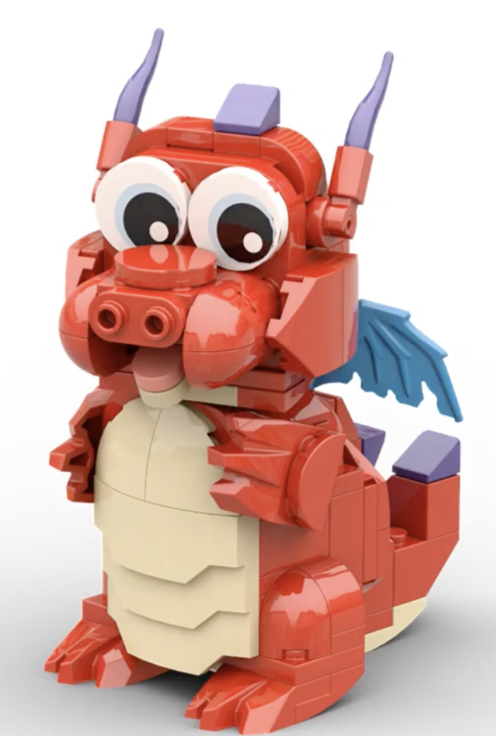

# About the club

A new name. A wider world.

A community for adult builders. Public exhibitions for people of all ages.
Our name is changing; our love of building together is not.

Northern Illinois Brick Club.

---

## From NILTC to NILBC

Northern Illinois LEGO Train Club (NILTC) is becoming **Northern Illinois Brick Club (NILBC)**.
The new name removes the LEGO trademark from the club name and welcomes builders with more
interests. You will still see the NILTC name in earlier display photographs.

---

## The tracks stay

Trains remain part of what we build and exhibit. The broader name makes room for other
subjects alongside them, not in place of them. Buildings, creatures, vehicles, and landscapes
belong in that conversation too.

---

## Meet Matchstick

A familiar face for a new name.

Meet Matchstick, shown here in a brick-model rendering.

Matchstick is our brick-built dragon mascot. The oversized eyes, short legs, small wings,
and curled tail give him a friendly, slightly goofy character. Visible joints and construction
details keep him connected to the bricks we build with.

Red body, tan belly, blue wings, and purple accents: a distinctive little dragon,
not a replacement for the club's many kinds of creations.

Look closely for the joints and individual pieces that give Matchstick his brick-built personality.

---

## Build something with us

[Ask about membership](JOIN.md){ .club-button }

Just looking? [Explore our builds](BUILDS.md) or [visit an exhibition](VISIT.md).
