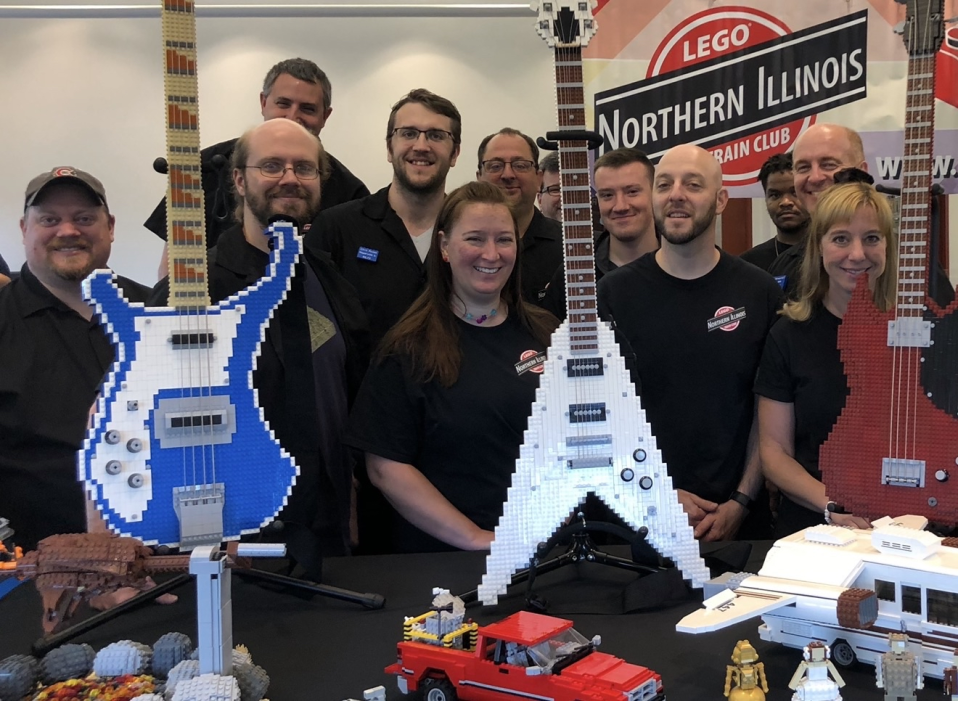
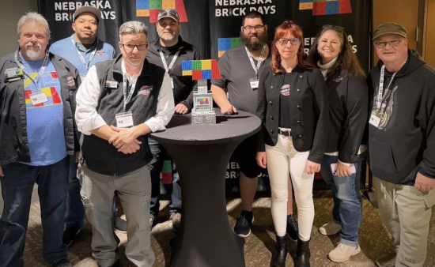

# Our builds

Not just tracks. Not just one way to build.

Trains are part of our heritage, not the limit of our imagination. The club's own display
photographs put oversized instruments beside small vehicles: different subjects, the same bricks.

The things we make.

---

## A closer look: brick-built instruments

The familiar shapes catch your eye first. Look again for the small choices that make them
recognizable: a stepped outline, a row of frets, a bridge, and a handful of controls.

### Blue, white, and four strings

The blue-and-white bass has a broad white face inside a stepped blue outline. Four visible
strings run along a tan neck toward a gray bridge. Round control details and rectangular
pickup-like pieces give the body more than just its silhouette.

### An unmistakable V

The white guitar trades curves for two long, pointed wings. Dark edging defines the opening
between them; pale fret bars cross a reddish-brown fingerboard. The partly pictured red
instrument beside it uses a contrasting rounded body and dark outer edge.

Brick-built instruments, a red pickup, and a white camper on the club's display table.
Photograph from the NILTC website.

The red pickup and white camper below the instruments bring the scene back to a smaller scale.
A display can reward both the first glance and the second, closer look.

---

## Built to be shared

A club is also the people around the table. This second photograph, shared on the club's
website, places a compact multicolored display in front of a group of event attendees.

Sharing the fun of building at an event. Photograph from the NILTC website.

See [CREDITS.md](CREDITS.md) for original files and attribution boundaries.

---

## What would you bring?

A railway, a city street, a creature, a landscape, or an idea nobody has seen before.
Your interests do not have to stop at trains.

[Ask about joining](JOIN.md){ .club-button }
