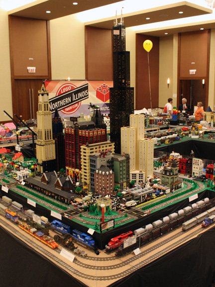
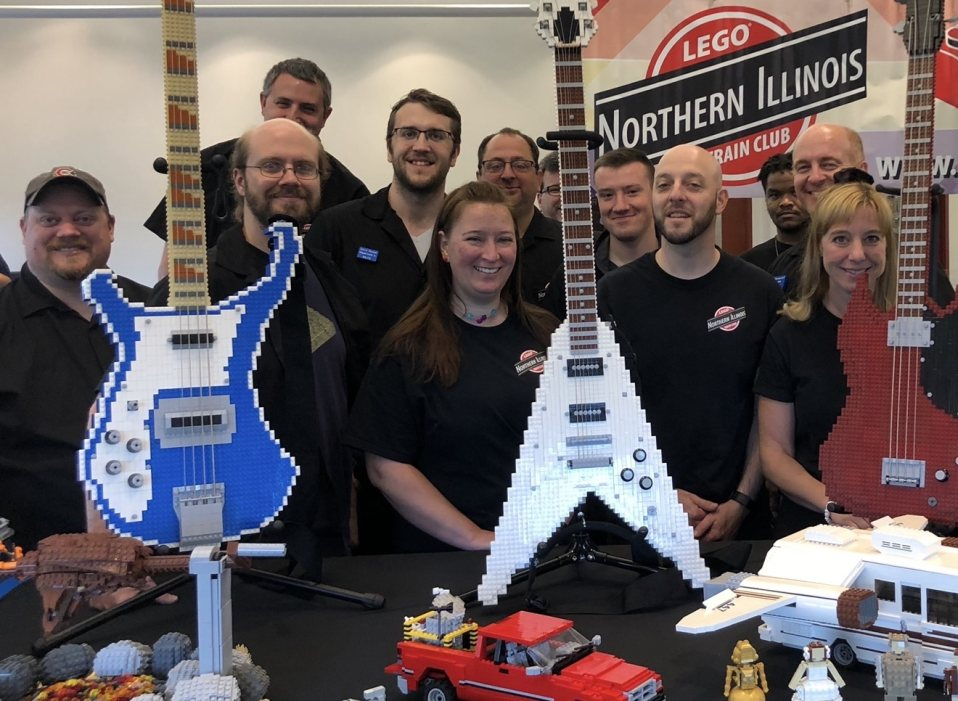

# Member creations

Trains are the spine, not the whole hobby. Members build town, space, city, castle, and other stories, and characters wander from one area into the next. Someone who builds mechs, mosaics, or spacecraft can still take part. If a module touches the shared lines, the current track and train notes on niltc.org are the ones the neighbors use.

## Published club photographs

Two pictures from niltc.org. The pages do not name the builders. More are on the [pictures page](https://niltc.org/pictures-and-videos) and in the [NILTC Flickr group](https://www.flickr.com/groups/niltc/pool/).

<figure class="evidence" markdown="1">

<figcaption>City and trains on one table. From IMG_1133.jpg on niltc.org. The photo metadata says 6 January 2011.</figcaption>
</figure>

<figure class="evidence" markdown="1">

<figcaption>Guitars, vehicles, and a dinosaur beside the members. Published on niltc.org on 28 June 2026 as IMG_2459.</figcaption>
</figure>

## If you connect track

The club's standards pages were not copied here. They still live under the NILTC name.

- [Track specifications](https://niltc.org/standards/track-specifications), updated 2 February 2025. Members supply the track for two main lines across their tables.
- [Train specifications](https://niltc.org/standards/train-specifications). The FAQ says club trains are battery powered, with an outer curve of R120 and an inner curve of R104.
- [Collaborative skyscraper display](https://niltc.org/standards/skyscrapers), for tall buildings that have to share a city block.

Read those pages before a show if your build meets someone else's track. Builders who are not connecting to the main lines are still part of the display.

