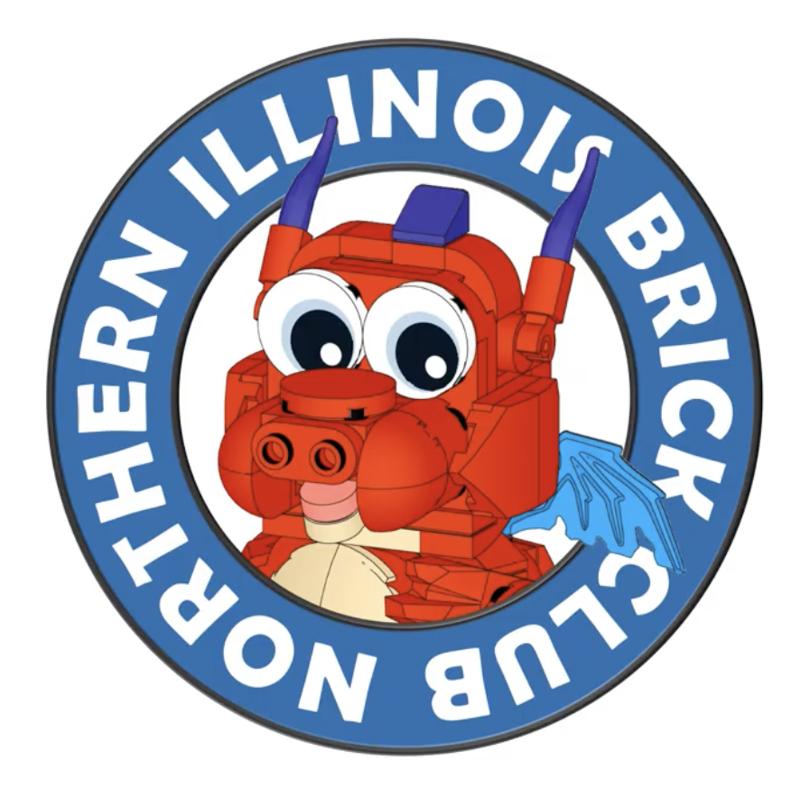

# About this club

Northern Illinois Brick Club is the new name for Northern Illinois LEGO Train Club. Dropping the trademark from the name matches what the membership page already says: this is not just a train club. People who build other things are invited in. Trains remain the piece that ties a show together.

## How it started

The [about page](club.md) says the club began in late summer 2001, when a few builders from Illinois and Wisconsin met. One person had been showing a small train locally. A larger shared display sounded better.

The first public display was in March 2002 at the National Model Railroad Association High Wheeler show, Harper College, Palatine. Five members set up a layout of about 17 by 22 feet. The about page says guests kept asking whether LEGO made trains, and that three people joined from that weekend.

Later in 2002 the club showed at a Train Collectors Association national show in St. Charles. In 2003, at the Illinois Railway Museum Day Out With Thomas in Union, the about page records a 40 by 40 foot tent, a 30 by 30 foot display, and 48,000 guests over two weekends.

The LEGO Ambassador Network listing, reviewed 16 March 2026, still describes an adult group established in 2001, with about 25 active members. The about page, last modified 24 June 2022, uses that same member figure. It is a published number, not a fresh count.

## No public clubhouse

The [FAQ](join.md), last modified 20 February 2023, says there is no permanent display. Members are spread across northern Illinois and southern Wisconsin. The club tries to meet once a quarter at members' homes in the western suburbs. That meeting rhythm is from the FAQ, not from a 2026 calendar.

The public email is [niltc.contact@gmail.com](mailto:niltc.contact@gmail.com). Do not treat any mailing address on a directory listing as a place to visit.

## Matchstick the mascot

<figure class="mascot" markdown="1">

</figure>

Matchstick is the club mascot for the NILBC name. He is a brick-built dragon, not a generic cartoon: a glossy red body, oversized eyes, purple horns, blue wings, a tan belly, short legs, and a curled tail. Studs and joints stay visible. The picture on this page is a render of that model, cropped to remove leftover slide text. It is not a photograph of a finished physical model.

The working digital colors are Red `#C91A09`, Tan `#E4CD9E`, Dark Azure `#078BC9` for the wings, and Medium Lavender `#AC78BA` for the horns and spikes. Eyes are white and pupils are near-black. These are working estimates from 19 October 2026. They are not a confirmed parts list. Shading in the render does not match the flat swatches.

{.mark}

The home banner pairs that portrait with the NILBC wordmark. The header repeats this circular mark. The full figure here is the same approved render. He does not replace the members' builds.

