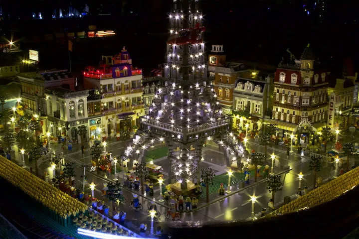
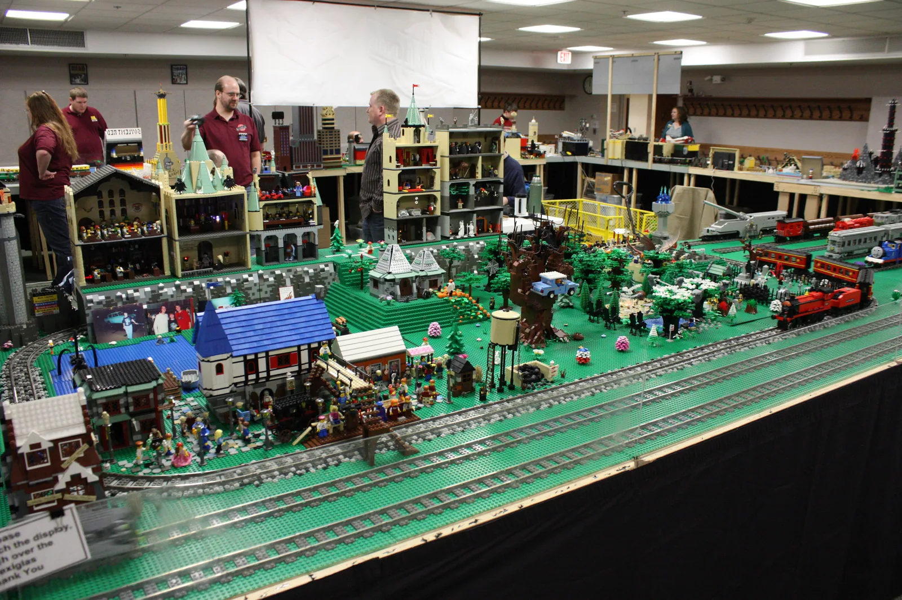
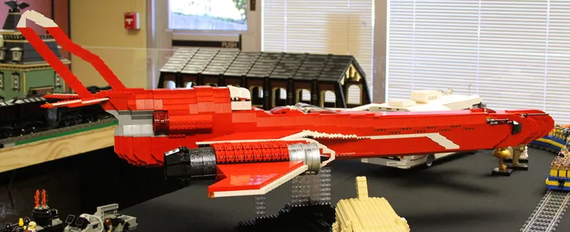
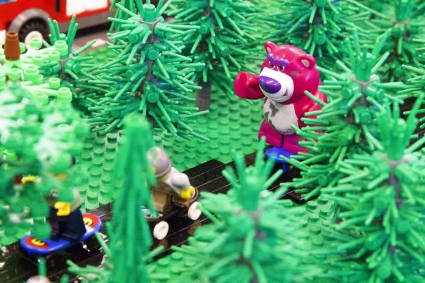
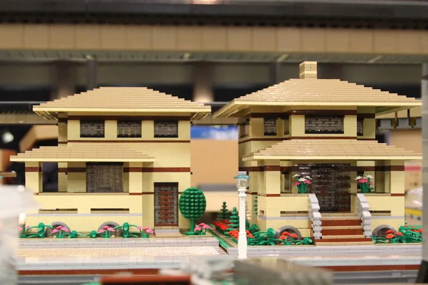
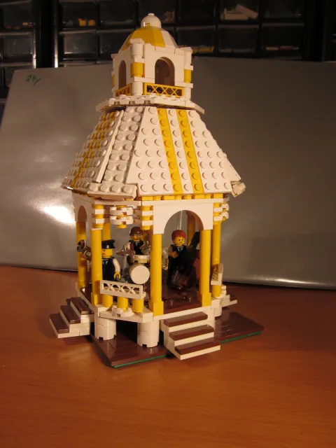

/// hero | Northern Illinois Brick Club (formerly NILTC)

# Every world, *brick by brick.*

We are adult builders from across northern Illinois. The trains still run, and the club now
has room for castles, skylines, starships, creatures, and whatever you build next.

[See upcoming shows](shows/index.md){ .md-button .md-button--primary }
[How to join](join/index.md){ .md-button }

[Meet Matchstick](about/matchstick.md)

/// next-show
///

///

## Three ways to get to know us { data-kicker="Start here" }

/// steps

1. **Visit a show**
   Most of our shows are in public libraries across the Chicago suburbs. Bring the family,
   watch the trains run, and look closely for the tiny stories hidden in each scene.
   [What to expect at a show](shows/visiting.md)
2. **Explore the worlds**
   Rail yards, skylines, landmarks, starships, castles, and creatures. See what members have
   built and put on display.
   [Browse member creations](creations/index.md)
3. **Bring your builds**
   Adults who love building in any theme are welcome. Email us, tell us what you build, and
   come to a meeting.
   [How membership works](join/index.md)

///

## Pick a world { data-kicker="Worlds we build" }

Matchstick, our brick-built dragon, travels to every world members create. Where will you
build?

/// worlds

### [Rail yards](creations/trains.md)

Where the club began. Locomotives and rolling stock run on shared track standards.

### [Cities and landmarks](creations/index.md#cities-and-landmarks)

Skyscrapers built to shared city blocks, prairie houses, and a lit Eiffel Tower.

### [Screen and story](creations/index.md#screen-and-story)

Famous starships, cartoon towns, and scenes from favorite stories.

### [Castles](creations/index.md#castles)

/// castle-module
///

The castle display joins members' modules into one kingdom.

### [Creatures and characters](creations/index.md#creatures-and-characters)

Frogs, bears, and characters with a lot of personality.

///

/// split

## Still a train club at heart { data-kicker="Trains included" }

The club started in 2001 as the Northern Illinois LEGO&reg; Train Club. Trains are still
the backbone of our layouts: Chicago commuter locomotives, freight lines, and steam engines
running loops around everything else members bring.

The table has always held more than trains: skyscrapers, castles, Paris at night, and a
very happy Unikitty. Our new name, **Northern Illinois Brick Club**, finally says so.

[Why we changed our name](about/index.md#a-new-name-for-a-bigger-table){ .md-button }

---

///

/// stats

- **2001** Founded in late summer, first show in 2002
- **17 &times; 22 ft** Our first display, built by five members in 2002
- **20** Annual Christmas shows at Cantigny Park, through 2022
- **48,000** Guests at our biggest show, 2003

///

/// train

## Every world rides the same rails

[Come see the real thing](shows/index.md){ .md-button .md-button--primary }

///
