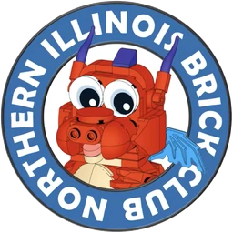

# Meet Matchstick

Matchstick is the club's brick-built dragon. He travels to every world members create and
plays in all of them: castle, space, pirates, trains, and whatever gets built next.

/// cards

### :material-earth: He goes everywhere

Matchstick fits into many themes, so members can include him in different parts of a
shared layout.

### :material-toy-brick-outline: He is fully buildable

Members can build copies of him, dress him for their own theme, and set him loose in their
part of the layout.

### :material-presentation: He speaks for the club

Look for him in presentations, classes, and on social media.

///

## Spot the parts

Each numbered part marks a feature that makes Matchstick recognizable. Adaptations of the
character should keep all of them.

/// callout | Provisional colors

The color names and values below are a working digital reference, estimated from the
rendered model shown here. They will be confirmed against the model's actual parts list.
Lighting and reflections change the colors in the pictures. Use these values as provisional
references until the parts list is confirmed.

///

/// split | parts

/// diagram | assets/mascot/matchstick_anatomy.svg
///

---

/// parts

1. **Horns** Two tall, curved purple horns. _Medium Lavender `#AC78BA`_
2. **Oversized eyes** Big white eyes with near-black pupils give his friendly, slightly
   goofy look. _White `#FFFFFF`, Black `#05131D`_
3. **Brick-built snout** A wide snout with two round nostrils, plainly made from parts.
   _Red `#C91A09`_
4. **Cream belly** Stacked, plate-like belly panels and a matching lower jaw.
   _Tan `#E4CD9E`_
5. **Short legs** Compact legs and clawed feet keep him low and sturdy. _Red `#C91A09`_
6. **Back spike** A purple slope on top of his head and along his back.
   _Medium Lavender `#AC78BA`_
7. **Small wings** Little blue wings, too small for flying and just right for him.
   _Dark Azure `#078BC9`_
8. **Tail spikes** Purple accents running down the tail. _Medium Lavender `#AC78BA`_
9. **Curled tail** A red tail that curls around behind him. _Red `#C91A09`_

///

///

## The club identity

Matchstick appears on the club's approved round logo and banner for the Northern Illinois
Brick Club name.

/// split

///
