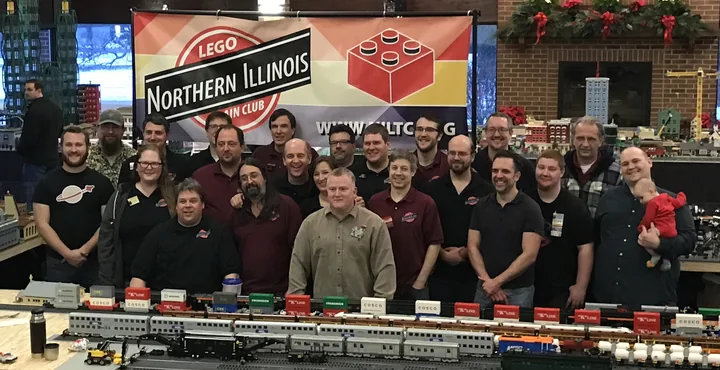
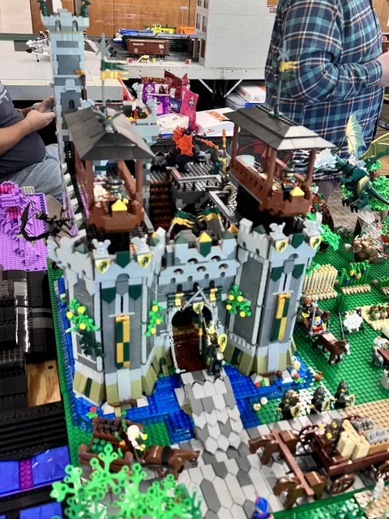

# Our story in bricks

A bigger train layout was the starting idea. The story since then is about the people,
places, and miniature worlds that have gathered around it.

A few stops along the way, not every show. Open a photograph
for its larger local image; expand a note for the story behind the date.

<section class="nb-timeline-entry nb-timeline-origin" markdown="1">

## Late summer 2001: Let's build bigger

A few enthusiasts from Illinois and Wisconsin met with an idea: take one member's small
local train display and make something larger together. The Northern Illinois LEGO Train
Club began with a logo, shared building parameters, and a first show to prepare for.[1]

</section>

<section class="nb-timeline-entry nb-timeline-first-show" markdown="1">

## 2002: Five builders, one layout

At the NMRA High Wheeler Show at Harper College in Palatine, five members filled a
17-by-22-foot display. Later that year, an invitation took the club to the Train Collectors
Association national show in St. Charles.[1]

The surprise was not just the trains

The club's history recalls visitors saying they had not known LEGO made trains.
It also records three members joining after Harper and two after the TCA show: the
exhibitions were bringing builders together as well as entertaining visitors.[1]

</section>

<section class="nb-timeline-entry nb-timeline-museum" markdown="1">

## 2003: A world under canvas

For the Illinois Railway Museum's *Day Out With Thomas* in Union, the club built a
30-by-30-foot layout inside a 40-by-40-foot tent. Its history recalls 48,000 guests across
the event's two weekends.[1]

Reading the historical record

That attendance figure comes from the club's retrospective account of the event, not a
separate count of visitors to its layout. The old page calls it the largest attendance
"to date"; this timeline does not treat that undated comparison as a current record.[1]

</section>

<section class="nb-timeline-entry nb-timeline-libraries" markdown="1">

## 2010 onward: Among the books

The public show log records Arlington Heights Memorial Library in September 2010,
then Helen Plum, Geneva, Crystal Lake, and Glen Ellyn libraries in 2011. Libraries recur
through the later years: places to encounter a miniature world close to home.[2]

This is a documented stretch of the story, not a claim that 2010 was the club's first
library show.

</section>

<section class="nb-timeline-entry nb-timeline-cantigny" markdown="1">

## December 2016: The people behind it

<figure class="nb-timeline-photo" markdown="1">

[{ loading=lazy }](../assets/photos/cantigny_group_2016.webp)

<figcaption>Cantigny, December 2016. Photo: NILTC / niltc.org.[1]</figcaption>
</figure>

The group photograph puts faces to a long-running holiday show. The club's history says
Cantigny's Christmas train exhibition began as a way to bring visitors to the park in the
off-season; it reports more than 10,800 visitors in 2011.[1]

A later holiday milestone

The show log lists December 10&ndash;11, 2022 at Cantigny as the **20th Annual LEGO Christmas
Show**. That is the event's recorded title, not evidence of twenty uninterrupted years at
one venue: the same log places the 2017 Christmas show in Warrenville.[2]

</section>

<section class="nb-timeline-entry nb-timeline-castle" markdown="1">

## 2025&ndash;2026: Beyond the railway

<figure class="nb-timeline-photo" markdown="1">

[{ loading=lazy }](../assets/photos/oswego_fortress_2025.webp)

<figcaption>Oswego, October 2025. NILTC archive; uploaded by Andertoons.</figcaption>
</figure>

<figure class="nb-timeline-photo" markdown="1">

[{ loading=lazy }](../assets/photos/ela_castle_2026.webp)

<figcaption>Ela Area, September 2026. NILTC archive; uploaded by Kerbear.</figcaption>
</figure>

Towers and drawbridges in Oswego; a hall and livestock yard at Ela Area. These selected
show photographs offer two views of castle building, rather than a before-and-after of
one model. Both shows appear in the public log.[2]

How separate worlds can meet

The club's public *Collaborative Castle Display* proposal describes independent modules
joined by shared road connections, terrain colors, and dimensions. It explicitly welcomes
fantasy and humor, and aims to show that the club builds more than trains.[4]

The proposal is undated. These photographs do not establish when that project began,
which pictured models follow its standards, or how a particular castle evolved.

</section>

<section class="nb-timeline-entry nb-timeline-recent" markdown="1">

## October 2026: A street to explore

<figure class="nb-timeline-photo" markdown="1">

[{ loading=lazy }](../assets/photos/northbrook_street_2026.webp)

<figcaption>Northbrook, October 2026. NILTC archive; uploaded by Kerbear.</figcaption>
</figure>

The show log records Northbrook Public Library on October 17&ndash;18. The library's own
listing invited visitors to discover spaceships, cities, castles, and more: a broad welcome
under the familiar train-club name.[2][3]

Look closely at the bookshop, flowers, and elevated track in this selected show photograph.
For more recent scenes, explore the [show photo gallery](../shows/gallery.md).

</section>

<section class="nb-timeline-entry nb-timeline-next" markdown="1">

## A new name, more room

**Northern Illinois Brick Club** names the wider world of building the club welcomes.
The owner-approved identity includes **Matchstick**, our brick-built dragon mascot.
The trains remain part of the story.

Read [why the name is changing](index.md#a-new-name-for-a-bigger-table) and
[meet Matchstick](matchstick.md). This chapter is deliberately undated: the approved
identity is not evidence of a particular public launch day.

</section>

## Sources

Historical entries draw on the club's own account and public show log, with a venue listing
for Northbrook. Photographs reuse the site's credited, owner-authorized selections;
archive uploaders are not necessarily the photographers or builders. See
[credits and sources](credits.md) for photo provenance.

[1] [NILTC club history and Cantigny group photograph](https://niltc.org/about)

[2] [NILTC past shows](https://niltc.org/past-shows)

[3] [Northbrook Public Library: October 17, 2026 exhibit](https://visit.northbrook.info/event/14127359)

[4] [NILTC collaborative castle proposal and standards](https://niltc.org/castle)

