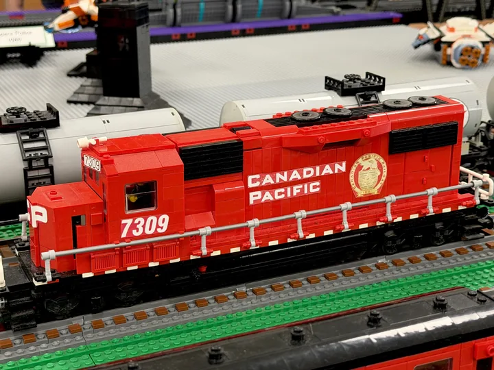
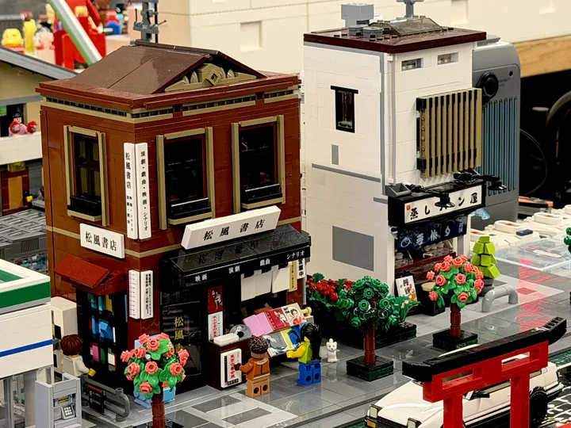
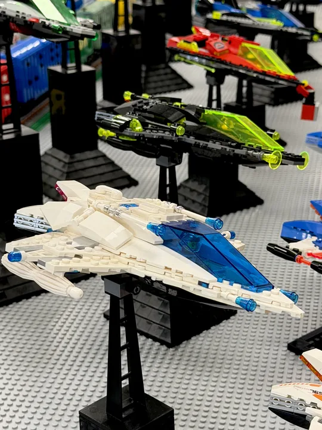
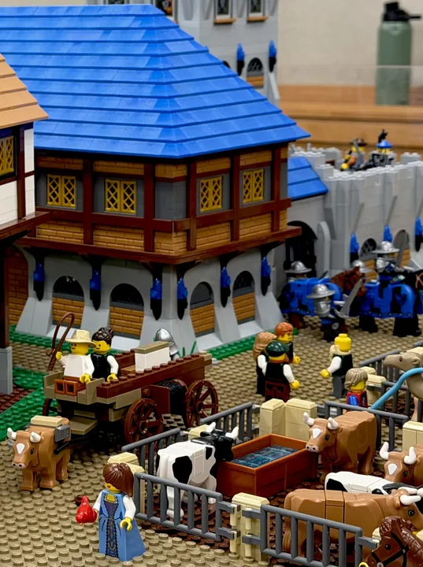
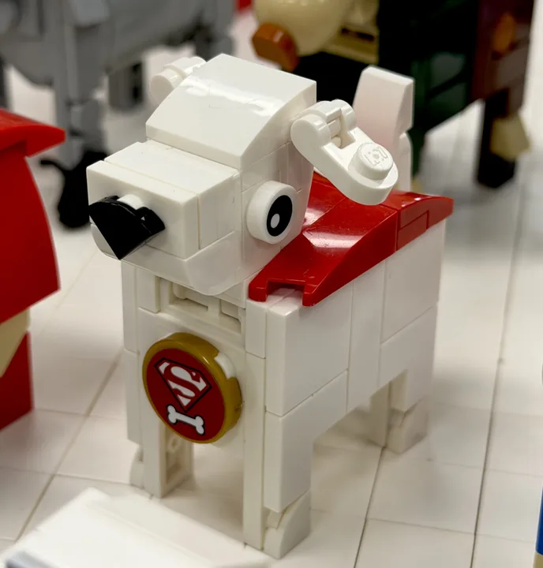

# Worlds we build

Club builds and displays from our website and show archives. Trains run through most of our
layouts, but members build whatever they love, as long as it is family friendly.

[Prefer to explore one show at a time? Browse the show photo gallery.](../shows/gallery.md)

/// world

## Trains and rail yards { #trains }

Running layouts are where the club began. Members build locomotives and rolling stock to
shared [train standards](../join/standards.md) so everything runs on one layout.

[Browse all trains photographs](trains.md)

///

/// world

## Cities and landmarks { #cities }

Skyscrapers built to shared city-block standards, prairie-style houses, local landmarks,
and small scenes worth bending down for.

[Browse all cities and landmarks photographs](cities.md)

///

/// world

## Screen and story { #screen }

Imagined worlds, favorite stories, starships, and aircraft.

[Browse all screen and story photographs](screen.md)

///

/// world

## Castles { #castles }

The castle display joins members' modules into one kingdom.

[Browse all castles photographs](castles.md)

/// split | module

/// castle-module
///

---

Since 2020 the castle display has joined members' modules into one kingdom. Every module is
15 by 60 inches, so walls, roads, and rivers line up from one builder's table to the next.
Minifigures are classic yellow.

Want to add a tower? Read the [castle standards](../join/standards.md#castle), then
[come build with us](../join/index.md).

///

///

/// world

## Creatures and characters { #creatures }

Not everything on the table runs on rails.

[Browse all creatures and characters photographs](creatures.md)

///

/// world

## The club

The people behind the bricks.

/// gallery | club
///

///

/// callout | Built one of these?

These photos come from the club's archive of past shows, where builders' names were not
recorded. If one of these models is yours, email
[niltc.contact@gmail.com](mailto:niltc.contact@gmail.com?subject=Photo%20credit) and we will
credit you. See [credits and sources](../about/credits.md).

///
