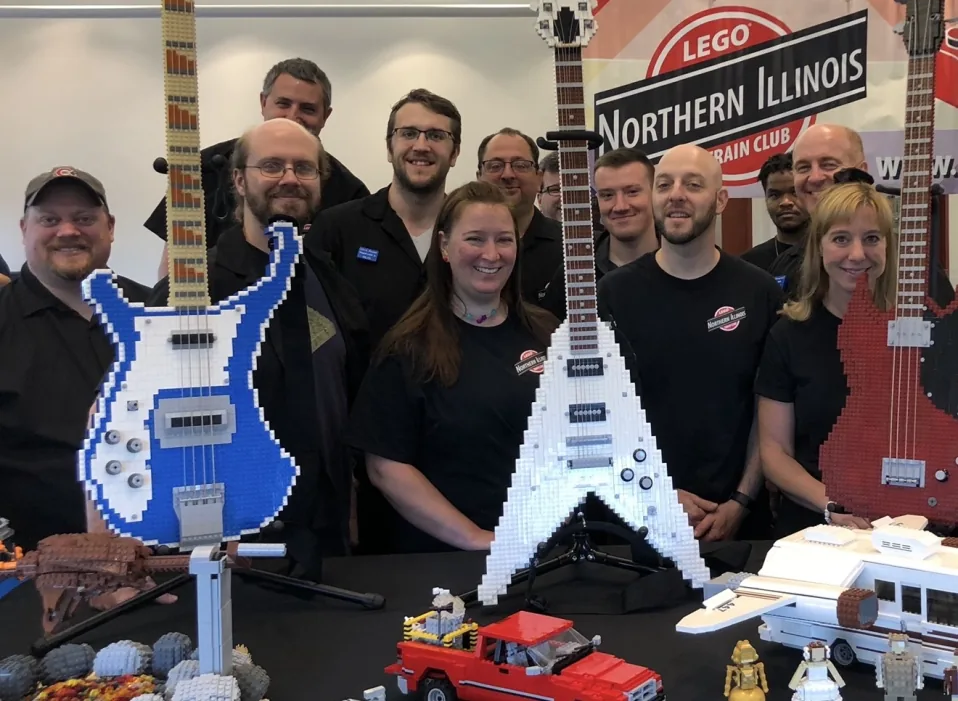
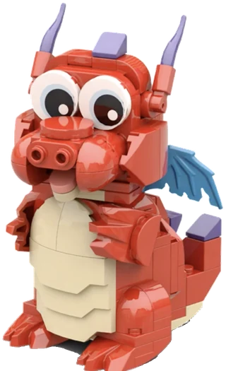

/// hero | Northern Illinois Brick Club (formerly NILTC)

# Many interests. *One club.*

We're adult LEGO builders from across northern Illinois. We build trains, castles,
skylines, starships, creatures, and more.

[See upcoming shows](shows/index.md){ .md-button .md-button--primary }
[How to join](join/index.md){ .md-button }

[Meet Matchstick](about/matchstick.md)

/// next-show
///

///

## Three ways to get to know us { data-kicker="Start here" }

/// steps

1. **Visit a show**
   All ages welcome. Watch the trains, explore the displays, and meet the builders.
   No membership needed.
   [What to expect at a show](shows/visiting.md)
2. **Explore the worlds**
   See the trains, buildings, and characters our members create.
   [Browse member creations](creations/index.md)
3. **Bring your builds**
   Adult builders of every theme are welcome. Tell us what you like to build.
   [How membership works](join/index.md)

///

## Pick a world { data-kicker="Worlds we build" }

Explore the trains, buildings, and characters members bring to our shows.

/// worlds

### [Rail yards](creations/index.md#rail-yards)

Where the club began. Locomotives and rolling stock run on shared track standards.

### [Cities and landmarks](creations/index.md#cities-and-landmarks)

Skyscrapers, prairie houses, and streets full of little stories.

### [Screen and story](creations/index.md#screen-and-story)

Famous starships, cartoon towns, and scenes from favorite stories.

### [Castles](creations/index.md#castles)

The castle display joins members' modules into one kingdom.

### [Creatures and characters](creations/index.md#creatures-and-characters)

Frogs, bears, and characters with a lot of personality.

///

/// split

## Members make all kinds of things { data-kicker="Built by the club" }

Members bring their own interests to our displays, from running trains to brick-built guitars.

[Get to know the club](about/index.md){ .md-button }

---

///

## Small scenes from our shows { data-kicker="Look closer" }

A harbor full of life, a barn-raising scene, and a woodland spider. A few details from
the displays our members bring to libraries across northern Illinois.

/// photos | barrington_harbor_2025 wheaton_barn_2026 oswego_spider_2025
///

[Browse photos by show](shows/gallery.md){ .md-button }

/// stats

- **2001** Founded in late summer, first show in 2002
- **17 &times; 22 ft** Our first display, built by five members in 2002
- **20** Annual Christmas shows at Cantigny Park, through 2022
- **48,000** Guests at our biggest show, 2003

///

/// train

## Every world rides the same rails

[Come see the real thing](shows/index.md){ .md-button .md-button--primary }

///
