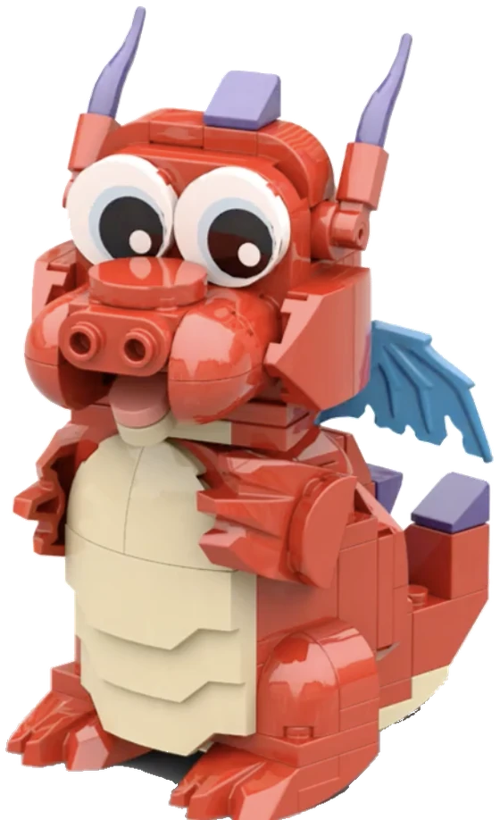

/// hero | Northern Illinois Brick Club (formerly NILTC)

# Many interests. *One club.*

We're adult LEGO builders from across northern Illinois. We build trains, castles,
skylines, starships, creatures, and more.

[See upcoming shows](shows/index.md){ .md-button .md-button--primary }
[How to join](join/index.md){ .md-button }

[Meet Matchstick](about/matchstick.md)

///

## At our shows

/// featured-photos
///

[Explore the show photographs](shows/gallery.md)

/// next-show
///

## Pick a world { data-kicker="Worlds we build" }

Explore the trains, buildings, and characters members bring to our shows.

/// worlds

### [Trains](creations/trains.md)

Where the club began. Locomotives and rolling stock run on shared track standards.

### [Cities and landmarks](creations/cities.md)

Skyscrapers, prairie houses, and streets full of little stories.

### [Screen and story](creations/screen.md)

Famous starships, cartoon towns, and scenes from favorite stories.

### [Castles](creations/castles.md)

The castle display joins members' modules into one kingdom.

### [Creatures and characters](creations/creatures.md)

Frogs, bears, and characters with a lot of personality.

///

