# Cities and landmarks

[README.md](README.md) / [shows.md](shows.md)

## northbrook_street_2026

Japanese bookshop at Northbrook, October 2026.

- Event date: 2026-10; capture date: unknown.
- Full image: 1600 x 1200 pixels; 251,602 bytes.
- Crop focus: 50% 52%. Focus controls display framing; follow the image link to inspect the full derivative.
- Homepage pick: yes.
- Credit: NILTC archive; uploaded by Kerbear.
- Show: [Northbrook Public Library](shows.md#2026-10-17-northbrook).
- Preserved original: [northbrook_street_2026.jpg](../../ARTIFACTS/discord_archive_shows/northbrook_street_2026.jpg).

## northbrook_boating_2026

[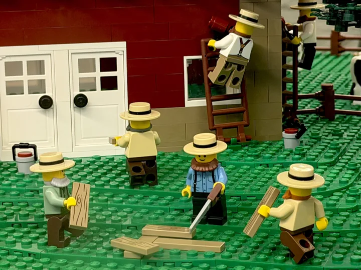](../../design_d_revised/site_src/assets/photos/northbrook_boating_2026.webp)

Boating party at Northbrook, October 2026.

- Event date: 2026-10; capture date: unknown.
- Full image: 1600 x 1200 pixels; 181,010 bytes.
- Crop focus: 50% 60%. Focus controls display framing; follow the image link to inspect the full derivative.
- Homepage pick: no.
- Credit: NILTC archive; uploaded by Kerbear.
- Show: [Northbrook Public Library](shows.md#2026-10-17-northbrook).
- Preserved original: [northbrook_boating_2026.jpg](../../ARTIFACTS/discord_archive_shows/northbrook_boating_2026.jpg).

## ela_interior_2026

[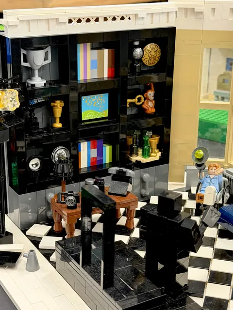](../../design_d_revised/site_src/assets/photos/ela_interior_2026.webp)

The trophy room.

- Event date: 2026-09; capture date: unknown.
- Full image: 1200 x 1600 pixels; 201,346 bytes.
- Crop focus: center (default). Focus controls display framing; follow the image link to inspect the full derivative.
- Homepage pick: no.
- Credit: NILTC archive; uploaded by Kerbear.
- Show: [Ela Area Public Library](shows.md#2026-09-12-ela-area).
- Preserved original: [ela_interior_2026.jpg](../../ARTIFACTS/discord_archive_shows/ela_interior_2026.jpg).

## ela_facade_2026

[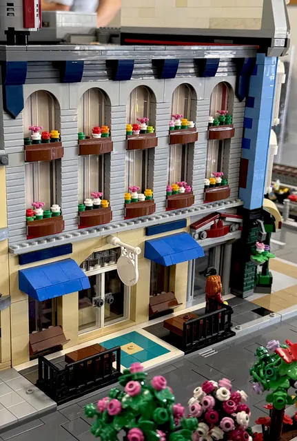](../../design_d_revised/site_src/assets/photos/ela_facade_2026.webp)

Flowers above the shop.

- Event date: 2026-09; capture date: unknown.
- Full image: 1078 x 1600 pixels; 215,026 bytes.
- Crop focus: center (default). Focus controls display framing; follow the image link to inspect the full derivative.
- Homepage pick: no.
- Credit: NILTC archive; uploaded by Kerbear.
- Show: [Ela Area Public Library](shows.md#2026-09-12-ela-area).
- Preserved original: [ela_facade_2026.jpg](../../ARTIFACTS/discord_archive_shows/ela_facade_2026.jpg).

## ela_aquarium_2026

[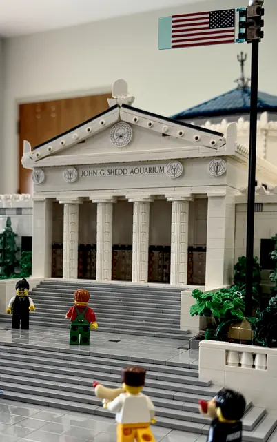](../../design_d_revised/site_src/assets/photos/ela_aquarium_2026.webp)

Chicago's Shedd Aquarium.

- Event date: 2026-09; capture date: unknown.
- Full image: 1006 x 1600 pixels; 138,020 bytes.
- Crop focus: center (default). Focus controls display framing; follow the image link to inspect the full derivative.
- Homepage pick: no.
- Credit: NILTC archive; uploaded by Kerbear.
- Show: [Ela Area Public Library](shows.md#2026-09-12-ela-area).
- Preserved original: [ela_aquarium_2026.jpg](../../ARTIFACTS/discord_archive_shows/ela_aquarium_2026.jpg).

## northbrook_coffee_2026

[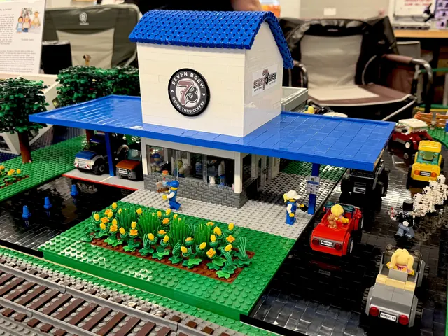](../../design_d_revised/site_src/assets/photos/northbrook_coffee_2026.webp)

Trackside coffee.

- Event date: 2026-10; capture date: unknown.
- Full image: 1600 x 1200 pixels; 343,406 bytes.
- Crop focus: center (default). Focus controls display framing; follow the image link to inspect the full derivative.
- Homepage pick: no.
- Credit: NILTC archive; uploaded by Kerbear.
- Show: [Northbrook Public Library](shows.md#2026-10-17-northbrook).
- Preserved original: [northbrook_coffee_2026.jpg](../../ARTIFACTS/discord_archive_shows/northbrook_coffee_2026.jpg).

## northbrook_cottage_2026

[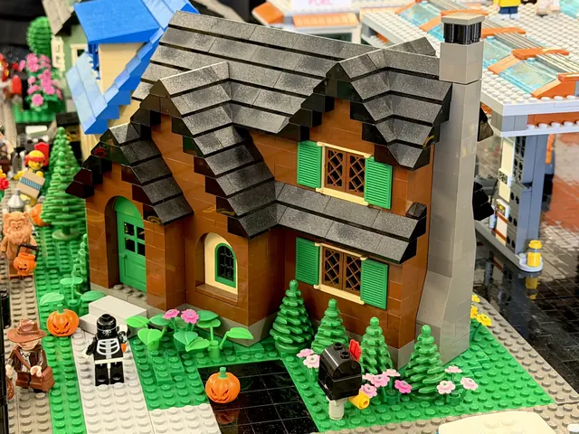](../../design_d_revised/site_src/assets/photos/northbrook_cottage_2026.webp)

Autumn cottage.

- Event date: 2026-10; capture date: unknown.
- Full image: 1600 x 1200 pixels; 349,266 bytes.
- Crop focus: center (default). Focus controls display framing; follow the image link to inspect the full derivative.
- Homepage pick: no.
- Credit: NILTC archive; uploaded by Kerbear.
- Show: [Northbrook Public Library](shows.md#2026-10-17-northbrook).
- Preserved original: [northbrook_cottage_2026.jpg](../../ARTIFACTS/discord_archive_shows/northbrook_cottage_2026.jpg).

## northbrook_tower_2026

[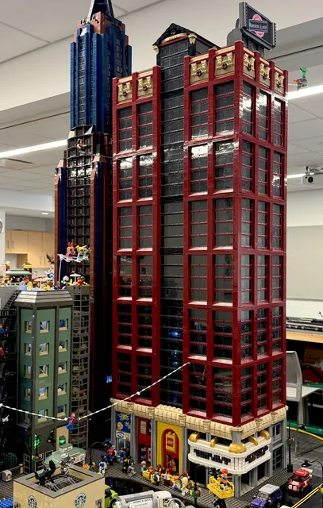](../../design_d_revised/site_src/assets/photos/northbrook_tower_2026.webp)

Club corner.

- Event date: 2026-10; capture date: unknown.
- Full image: 1017 x 1600 pixels; 287,570 bytes.
- Crop focus: center (default). Focus controls display framing; follow the image link to inspect the full derivative.
- Homepage pick: no.
- Credit: NILTC archive; uploaded by Kerbear.
- Show: [Northbrook Public Library](shows.md#2026-10-17-northbrook).
- Preserved original: [northbrook_tower_2026.jpg](../../ARTIFACTS/discord_archive_shows/northbrook_tower_2026.jpg).

## arlington_winter_market_2025

[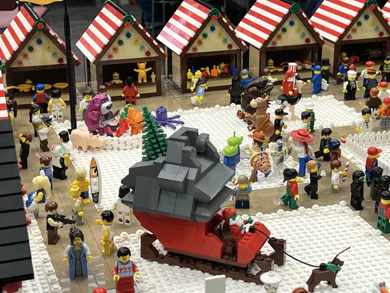](../../design_d_revised/site_src/assets/photos/arlington_winter_market_2025.webp)

Winter fair.

- Event date: 2025-12; capture date: unknown.
- Full image: 1600 x 1200 pixels; 243,662 bytes.
- Crop focus: center (default). Focus controls display framing; follow the image link to inspect the full derivative.
- Homepage pick: no.
- Credit: NILTC archive; uploaded by Kerbear.
- Show: [Arlington Heights Memorial Library](shows.md#2025-12-13-arlington-heights).
- Preserved original: [arlington_winter_market_2025.jpg](../../ARTIFACTS/discord_archive_shows/arlington_winter_market_2025.jpg).

## arlington_sailboat_2025

[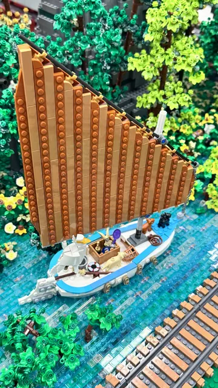](../../design_d_revised/site_src/assets/photos/arlington_sailboat_2025.webp)

Woodland harbor.

- Event date: 2025-12; capture date: unknown.
- Full image: 900 x 1600 pixels; 291,914 bytes.
- Crop focus: center (default). Focus controls display framing; follow the image link to inspect the full derivative.
- Homepage pick: no.
- Credit: NILTC archive; uploaded by Andertoons.
- Show: [Arlington Heights Memorial Library](shows.md#2025-12-13-arlington-heights).
- Preserved original: [arlington_sailboat_2025.jpg](../../ARTIFACTS/discord_archive_shows/arlington_sailboat_2025.jpg).

## barrington_landscape_2025

[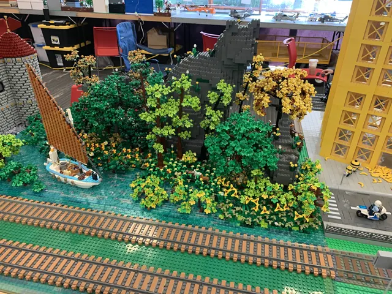](../../design_d_revised/site_src/assets/photos/barrington_landscape_2025.webp)

Riverside railway.

- Event date: 2025-09; capture date: unknown.
- Full image: 1600 x 1200 pixels; 444,918 bytes.
- Crop focus: center (default). Focus controls display framing; follow the image link to inspect the full derivative.
- Homepage pick: no.
- Credit: NILTC archive; uploaded by Jason C.
- Show: [Barrington Area Library](shows.md#2025-09-06-barrington).
- Preserved original: [barrington_landscape_2025.jpg](../../ARTIFACTS/discord_archive_shows/barrington_landscape_2025.jpg).

## algonquin_cyclist_2026

[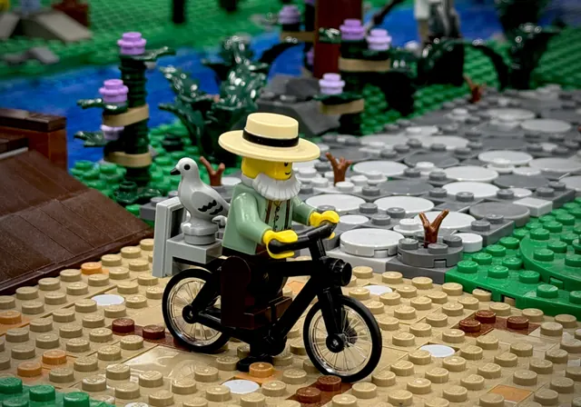](../../design_d_revised/site_src/assets/photos/algonquin_cyclist_2026.webp)

A feathered passenger.

- Event date: 2026-05; capture date: unknown.
- Full image: 1600 x 1121 pixels; 175,230 bytes.
- Crop focus: center (default). Focus controls display framing; follow the image link to inspect the full derivative.
- Homepage pick: no.
- Credit: NILTC archive; uploaded by Kerbear.
- Show: [Algonquin Area Public Library](shows.md#2026-05-02-algonquin).
- Preserved original: [algonquin_cyclist_2026.jpg](../../ARTIFACTS/discord_archive_shows/algonquin_cyclist_2026.jpg).

## algonquin_cars_2026

[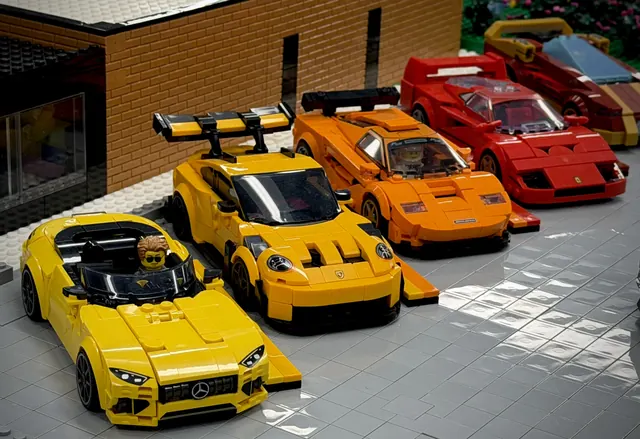](../../design_d_revised/site_src/assets/photos/algonquin_cars_2026.webp)

Sports car lineup.

- Event date: 2026-05; capture date: unknown.
- Full image: 1600 x 1098 pixels; 188,434 bytes.
- Crop focus: center (default). Focus controls display framing; follow the image link to inspect the full derivative.
- Homepage pick: no.
- Credit: NILTC archive; uploaded by Kerbear.
- Show: [Algonquin Area Public Library](shows.md#2026-05-02-algonquin).
- Preserved original: [algonquin_cars_2026.jpg](../../ARTIFACTS/discord_archive_shows/algonquin_cars_2026.jpg).

## wheaton_barn_2026

[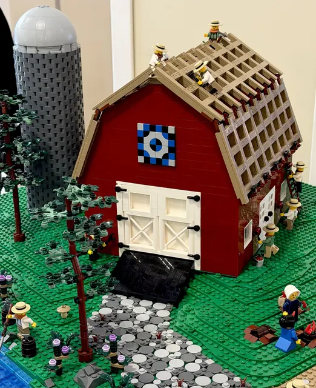](../../design_d_revised/site_src/assets/photos/wheaton_barn_2026.webp)

Barn raising.

- Event date: 2026-04; capture date: unknown.
- Full image: 1306 x 1600 pixels; 317,402 bytes.
- Crop focus: center (default). Focus controls display framing; follow the image link to inspect the full derivative.
- Homepage pick: no.
- Credit: NILTC archive; uploaded by Kerbear.
- Show: [Wheaton Public Library](shows.md#2026-04-11-wheaton).
- Preserved original: [wheaton_barn_2026.jpg](../../ARTIFACTS/discord_archive_shows/wheaton_barn_2026.jpg).

## wheaton_eloise_2026

[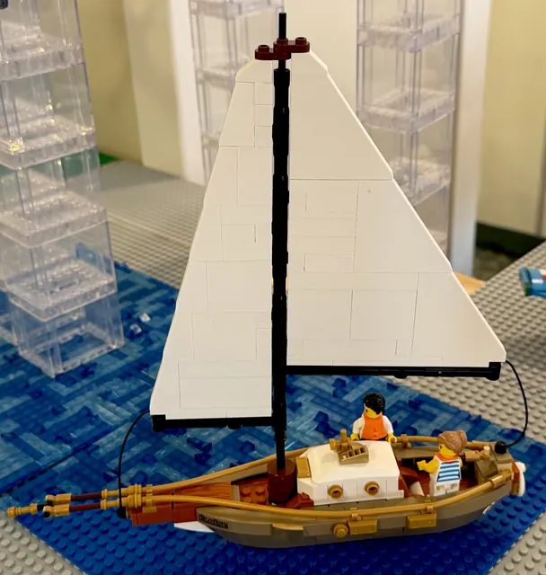](../../design_d_revised/site_src/assets/photos/wheaton_eloise_2026.webp)

Eloise under sail.

- Event date: 2026-04; capture date: unknown.
- Full image: 1520 x 1600 pixels; 131,860 bytes.
- Crop focus: center (default). Focus controls display framing; follow the image link to inspect the full derivative.
- Homepage pick: no.
- Credit: NILTC archive; uploaded by Kerbear.
- Show: [Wheaton Public Library](shows.md#2026-04-11-wheaton).
- Preserved original: [wheaton_eloise_2026.jpg](../../ARTIFACTS/discord_archive_shows/wheaton_eloise_2026.jpg).

## paris_night

Paris at Brickworld 2016.

- Event date: unknown; capture date: unknown.
- Full image: 900 x 600 pixels; 110,426 bytes.
- Crop focus: center (default). Focus controls display framing; follow the image link to inspect the full derivative.
- Homepage pick: no.
- Credit: NILTC / niltc.org.

## night_skyline

[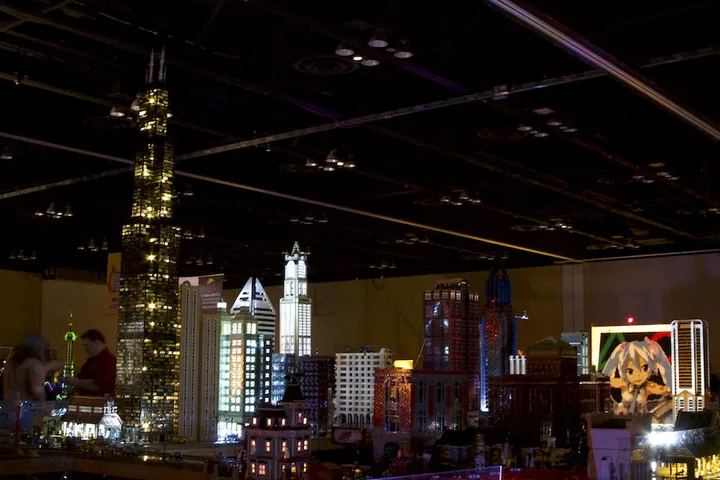](../../design_d_revised/site_src/assets/photos/night_skyline.webp)

Skyline after dark, June 2015.

- Event date: unknown; capture date: unknown.
- Full image: 900 x 600 pixels; 67,578 bytes.
- Crop focus: 50% 88%. Focus controls display framing; follow the image link to inspect the full derivative.
- Homepage pick: no.
- Credit: NILTC / niltc.org.

## skyscrapers

[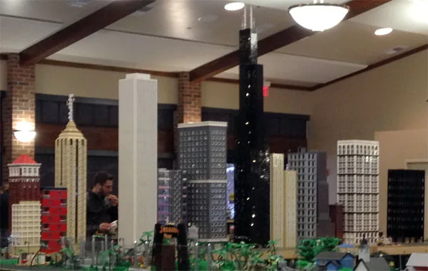](../../design_d_revised/site_src/assets/photos/skyscrapers.webp)

Roger's nine-foot Sears Tower in the shared skyline.

- Event date: unknown; capture date: unknown.
- Full image: 600 x 381 pixels; 28,310 bytes.
- Crop focus: center (default). Focus controls display framing; follow the image link to inspect the full derivative.
- Homepage pick: no.
- Credit: NILTC / niltc.org.

## prairie_bungalow

Prairie-style houses.

- Event date: unknown; capture date: unknown.
- Full image: 900 x 600 pixels; 54,068 bytes.
- Crop focus: center (default). Focus controls display framing; follow the image link to inspect the full derivative.
- Homepage pick: no.
- Credit: NILTC / niltc.org.

## museum_replica

[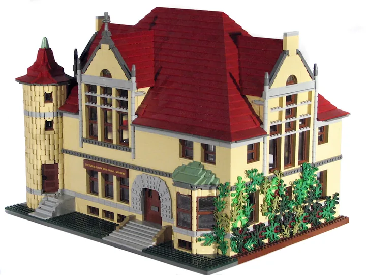](../../design_d_revised/site_src/assets/photos/museum_replica.webp)

DuPage County Historical Museum.

- Event date: unknown; capture date: unknown.
- Full image: 900 x 675 pixels; 77,142 bytes.
- Crop focus: center (default). Focus controls display framing; follow the image link to inspect the full derivative.
- Homepage pick: no.
- Credit: NILTC / niltc.org.

## gazebo

The bandstand.

- Event date: unknown; capture date: unknown.
- Full image: 480 x 640 pixels; 27,226 bytes.
- Crop focus: center (default). Focus controls display framing; follow the image link to inspect the full derivative.
- Homepage pick: no.
- Credit: NILTC / niltc.org.

## teacup

[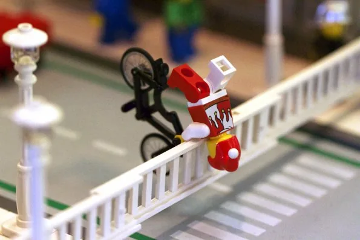](../../design_d_revised/site_src/assets/photos/teacup.webp)

A hidden city scene.

- Event date: unknown; capture date: unknown.
- Full image: 595 x 397 pixels; 19,932 bytes.
- Crop focus: center (default). Focus controls display framing; follow the image link to inspect the full derivative.
- Homepage pick: no.
- Credit: NILTC / niltc.org.
