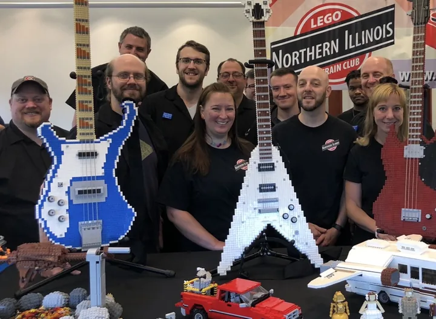
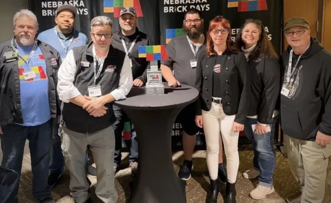

# The club

[README.md](README.md) / [shows.md](shows.md)

## club_group_2026

Guitars and vehicles.

- Event date: unknown; capture date: unknown.
- Full image: 958 x 701 pixels; 83,390 bytes.
- Crop focus: center (default). Focus controls display framing; follow the image link to inspect the full derivative.
- Homepage pick: no.
- Credit: NILTC / niltc.org.

## brick_days_2026

Members at Nebraska Brick Days.

- Event date: unknown; capture date: unknown.
- Full image: 550 x 338 pixels; 33,636 bytes.
- Crop focus: center (default). Focus controls display framing; follow the image link to inspect the full derivative.
- Homepage pick: no.
- Credit: NILTC / niltc.org.

## cantigny_group_2016

The club at Cantigny Park, December 2016.

- Event date: unknown; capture date: unknown.
- Full image: 1600 x 822 pixels; 169,990 bytes.
- Crop focus: center (default). Focus controls display framing; follow the image link to inspect the full derivative.
- Homepage pick: no.
- Credit: NILTC / niltc.org.
