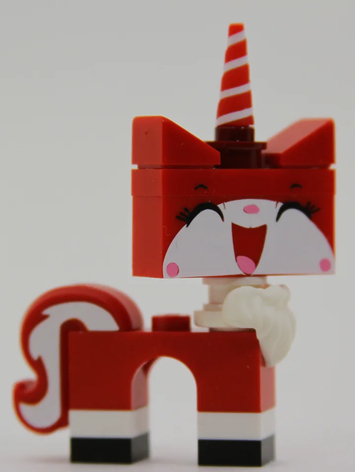
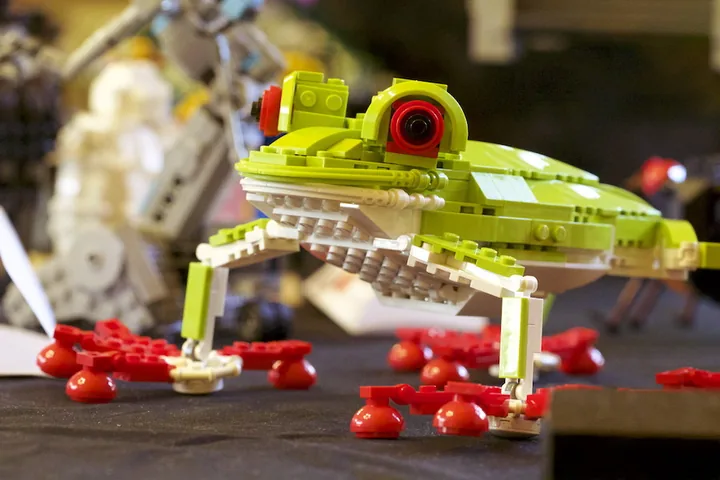

# Creatures and characters

[README.md](README.md) / [shows.md](shows.md)

## ela_dog_2026

Superhero dog at Ela Area, September 2026.

- Event date: 2026-09; capture date: unknown.
- Full image: 1529 x 1600 pixels; 62,124 bytes.
- Crop focus: 50% 45%. Focus controls display framing; follow the image link to inspect the full derivative.
- Homepage pick: no.
- Credit: NILTC archive; uploaded by Kerbear.
- Show: [Ela Area Public Library](shows.md#2026-09-12-ela-area).
- Preserved original: [ela_dog_2026.jpg](../../ARTIFACTS/discord_archive_shows/ela_dog_2026.jpg).

## ela_characters_2026

Space explorers at Ela Area, September 2026.

- Event date: 2026-09; capture date: unknown.
- Full image: 1600 x 1200 pixels; 92,370 bytes.
- Crop focus: 55% 35%. Focus controls display framing; follow the image link to inspect the full derivative.
- Homepage pick: no.
- Credit: NILTC archive; uploaded by Kerbear.
- Show: [Ela Area Public Library](shows.md#2026-09-12-ela-area).
- Preserved original: [ela_characters_2026.jpg](../../ARTIFACTS/discord_archive_shows/ela_characters_2026.jpg).

## northbrook_party_2026

Party on wheels.

- Event date: 2026-10; capture date: unknown.
- Full image: 1600 x 1190 pixels; 163,546 bytes.
- Crop focus: center (default). Focus controls display framing; follow the image link to inspect the full derivative.
- Homepage pick: no.
- Credit: NILTC archive; uploaded by Kerbear.
- Show: [Northbrook Public Library](shows.md#2026-10-17-northbrook).
- Preserved original: [northbrook_party_2026.jpg](../../ARTIFACTS/discord_archive_shows/northbrook_party_2026.jpg).

## arlington_dinosaurs_2025

Dinosaur grocery run.

- Event date: 2025-12; capture date: unknown.
- Full image: 1600 x 1200 pixels; 262,780 bytes.
- Crop focus: center (default). Focus controls display framing; follow the image link to inspect the full derivative.
- Homepage pick: no.
- Credit: NILTC archive; uploaded by Kerbear.
- Show: [Arlington Heights Memorial Library](shows.md#2025-12-13-arlington-heights).
- Preserved original: [arlington_dinosaurs_2025.jpg](../../ARTIFACTS/discord_archive_shows/arlington_dinosaurs_2025.jpg).

## arlington_santa_2025

Santa takes the high road.

- Event date: 2025-12; capture date: unknown.
- Full image: 1600 x 1200 pixels; 164,124 bytes.
- Crop focus: center (default). Focus controls display framing; follow the image link to inspect the full derivative.
- Homepage pick: no.
- Credit: NILTC archive; uploaded by Andertoons.
- Show: [Arlington Heights Memorial Library](shows.md#2025-12-13-arlington-heights).
- Preserved original: [arlington_santa_2025.jpg](../../ARTIFACTS/discord_archive_shows/arlington_santa_2025.jpg).

## oswego_spider_2025

Woodland spider.

- Event date: 2025-10; capture date: unknown.
- Full image: 1600 x 1200 pixels; 245,372 bytes.
- Crop focus: center (default). Focus controls display framing; follow the image link to inspect the full derivative.
- Homepage pick: no.
- Credit: NILTC archive; uploaded by Andertoons.
- Show: [Oswego Public Library](shows.md#2025-10-25-oswego).
- Preserved original: [oswego_spider_2025.jpg](../../ARTIFACTS/discord_archive_shows/oswego_spider_2025.jpg).

## barrington_harbor_2025

Whales in the harbor.

- Event date: 2025-09; capture date: unknown.
- Full image: 1600 x 1200 pixels; 284,842 bytes.
- Crop focus: center (default). Focus controls display framing; follow the image link to inspect the full derivative.
- Homepage pick: no.
- Credit: NILTC archive; uploaded by Jason C.
- Show: [Barrington Area Library](shows.md#2025-09-06-barrington).
- Preserved original: [barrington_harbor_2025.jpg](../../ARTIFACTS/discord_archive_shows/barrington_harbor_2025.jpg).

## algonquin_animals_2026

Animal portraits.

- Event date: 2026-05; capture date: unknown.
- Full image: 1600 x 1188 pixels; 137,898 bytes.
- Crop focus: center (default). Focus controls display framing; follow the image link to inspect the full derivative.
- Homepage pick: no.
- Credit: NILTC archive; uploaded by Kerbear.
- Show: [Algonquin Area Public Library](shows.md#2026-05-02-algonquin).
- Preserved original: [algonquin_animals_2026.jpg](../../ARTIFACTS/discord_archive_shows/algonquin_animals_2026.jpg).

## wheaton_horses_2026

Horses by the river.

- Event date: 2026-04; capture date: unknown.
- Full image: 1600 x 1200 pixels; 181,516 bytes.
- Crop focus: center (default). Focus controls display framing; follow the image link to inspect the full derivative.
- Homepage pick: no.
- Credit: NILTC archive; uploaded by Kerbear.
- Show: [Wheaton Public Library](shows.md#2026-04-11-wheaton).
- Preserved original: [wheaton_horses_2026.jpg](../../ARTIFACTS/discord_archive_shows/wheaton_horses_2026.jpg).

## unikitty

Unikitty.

- Event date: unknown; capture date: unknown.
- Full image: 1600 x 2128 pixels; 82,164 bytes.
- Crop focus: center (default). Focus controls display framing; follow the image link to inspect the full derivative.
- Homepage pick: no.
- Credit: NILTC / niltc.org.

## frog

Red-eyed frog.

- Event date: unknown; capture date: unknown.
- Full image: 900 x 600 pixels; 49,280 bytes.
- Crop focus: center (default). Focus controls display framing; follow the image link to inspect the full derivative.
- Homepage pick: no.
- Credit: NILTC / niltc.org.

## bear_woods

Pink bear in the pines.

- Event date: unknown; capture date: unknown.
- Full image: 595 x 397 pixels; 50,192 bytes.
- Crop focus: center (default). Focus controls display framing; follow the image link to inspect the full derivative.
- Homepage pick: no.
- Credit: NILTC / niltc.org.
