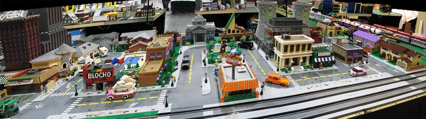
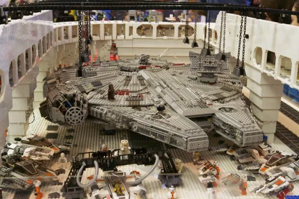

# Screen and story

[README.md](README.md) / [shows.md](shows.md)

## ela_spacecraft_2026

Space fleet at Ela Area, September 2026.

- Event date: 2026-09; capture date: unknown.
- Full image: 1200 x 1600 pixels; 180,176 bytes.
- Crop focus: 50% 75%. Focus controls display framing; follow the image link to inspect the full derivative.
- Homepage pick: no.
- Credit: NILTC archive; uploaded by Kerbear.
- Show: [Ela Area Public Library](shows.md#2026-09-12-ela-area).
- Preserved original: [ela_spacecraft_2026.jpg](../../ARTIFACTS/discord_archive_shows/ela_spacecraft_2026.jpg).

## ela_spider_riders_2026

Spider patrol.

- Event date: 2026-09; capture date: unknown.
- Full image: 1282 x 1600 pixels; 177,448 bytes.
- Crop focus: center (default). Focus controls display framing; follow the image link to inspect the full derivative.
- Homepage pick: no.
- Credit: NILTC archive; uploaded by Kerbear.
- Show: [Ela Area Public Library](shows.md#2026-09-12-ela-area).
- Preserved original: [ela_spider_riders_2026.jpg](../../ARTIFACTS/discord_archive_shows/ela_spider_riders_2026.jpg).

## oswego_helicopter_2025

Heavy lift.

- Event date: 2025-10; capture date: unknown.
- Full image: 1600 x 1600 pixels; 256,294 bytes.
- Crop focus: center (default). Focus controls display framing; follow the image link to inspect the full derivative.
- Homepage pick: no.
- Credit: NILTC archive; uploaded by Andertoons.
- Show: [Oswego Public Library](shows.md#2025-10-25-oswego).
- Preserved original: [oswego_helicopter_2025.jpg](../../ARTIFACTS/discord_archive_shows/oswego_helicopter_2025.jpg).

## oswego_hippogriff_2025

Hippogriff encounter.

- Event date: 2025-10; capture date: unknown.
- Full image: 1200 x 1600 pixels; 224,372 bytes.
- Crop focus: center (default). Focus controls display framing; follow the image link to inspect the full derivative.
- Homepage pick: no.
- Credit: NILTC archive; uploaded by Andertoons.
- Show: [Oswego Public Library](shows.md#2025-10-25-oswego).
- Preserved original: [oswego_hippogriff_2025.jpg](../../ARTIFACTS/discord_archive_shows/oswego_hippogriff_2025.jpg).

## barrington_aircraft_2025

On the airfield.

- Event date: 2025-09; capture date: unknown.
- Full image: 1600 x 1200 pixels; 323,866 bytes.
- Crop focus: center (default). Focus controls display framing; follow the image link to inspect the full derivative.
- Homepage pick: no.
- Credit: NILTC archive; uploaded by Jason C.
- Show: [Barrington Area Library](shows.md#2025-09-06-barrington).
- Preserved original: [barrington_aircraft_2025.jpg](../../ARTIFACTS/discord_archive_shows/barrington_aircraft_2025.jpg).

## algonquin_jet_2026

Blue and yellow, from the nose to the tail.

- Event date: 2026-05; capture date: unknown.
- Full image: 1600 x 1155 pixels; 135,826 bytes.
- Crop focus: center (default). Focus controls display framing; follow the image link to inspect the full derivative.
- Homepage pick: no.
- Credit: NILTC archive; uploaded by Kerbear.
- Show: [Algonquin Area Public Library](shows.md#2026-05-02-algonquin).
- Preserved original: [algonquin_jet_2026.jpg](../../ARTIFACTS/discord_archive_shows/algonquin_jet_2026.jpg).

## algonquin_classic_space_2026

Classic Space, reimagined.

- Event date: 2026-05; capture date: unknown.
- Full image: 1440 x 1600 pixels; 187,906 bytes.
- Crop focus: center (default). Focus controls display framing; follow the image link to inspect the full derivative.
- Homepage pick: no.
- Credit: NILTC archive; uploaded by Kerbear.
- Show: [Algonquin Area Public Library](shows.md#2026-05-02-algonquin).
- Preserved original: [algonquin_classic_space_2026.jpg](../../ARTIFACTS/discord_archive_shows/algonquin_classic_space_2026.jpg).

## springfield

Cartoon town.

- Event date: unknown; capture date: unknown.
- Full image: 1600 x 446 pixels; 184,006 bytes.
- Crop focus: center (default). Focus controls display framing; follow the image link to inspect the full derivative.
- Homepage pick: no.
- Credit: NILTC / niltc.org.

## falcon_bay

Starship hangar.

- Event date: unknown; capture date: unknown.
- Full image: 595 x 397 pixels; 61,210 bytes.
- Crop focus: center (default). Focus controls display framing; follow the image link to inspect the full derivative.
- Homepage pick: no.
- Credit: NILTC / niltc.org.

## jet

Red jet.

- Event date: unknown; capture date: unknown.
- Full image: 1088 x 444 pixels; 66,552 bytes.
- Crop focus: center (default). Focus controls display framing; follow the image link to inspect the full derivative.
- Homepage pick: no.
- Credit: NILTC / niltc.org.
