# Photographs by show

[README.md](README.md)

Albums are listed by verified event date, newest first. Image order follows the site manifest.

## 2026-10-17-northbrook

Northbrook Public Library - October 2026

City corners, rolling stock, and small scenes beside the tracks.

| Preview | Photograph | Theme |
| --- | --- | --- |
|  | [northbrook_street_2026](city.md#northbrook_street_2026) | Cities and landmarks |
|  | [northbrook_coffee_2026](city.md#northbrook_coffee_2026) | Cities and landmarks |
|  | [northbrook_boating_2026](city.md#northbrook_boating_2026) | Cities and landmarks |
|  | [northbrook_cottage_2026](city.md#northbrook_cottage_2026) | Cities and landmarks |
|  | [northbrook_depot_2026](trains.md#northbrook_depot_2026) | Rail yards |
|  | [northbrook_crane_2026](trains.md#northbrook_crane_2026) | Rail yards |
|  | [northbrook_freight_2026](trains.md#northbrook_freight_2026) | Rail yards |
|  | [northbrook_tower_2026](city.md#northbrook_tower_2026) | Cities and landmarks |
| 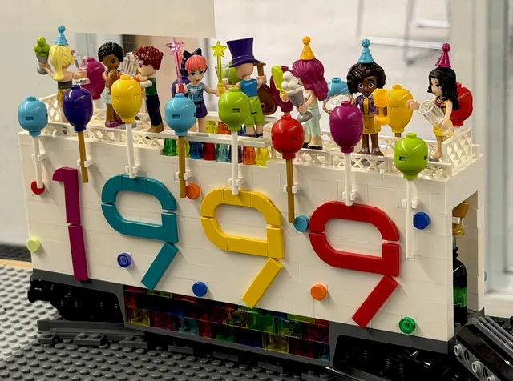 | [northbrook_party_2026](creatures.md#northbrook_party_2026) | Creatures and characters |
|  | [northbrook_purple_train_2026](trains.md#northbrook_purple_train_2026) | Rail yards |
|  | [northbrook_1999_railcar_2026](trains.md#northbrook_1999_railcar_2026) | Rail yards |

## 2026-09-12-ela-area

Ela Area Public Library - September 2026

Castle courtyards, Chicago architecture, spacecraft, and larger-than-life characters.

| Preview | Photograph | Theme |
| --- | --- | --- |
|  | [ela_castle_2026](castle.md#ela_castle_2026) | Castles |
| 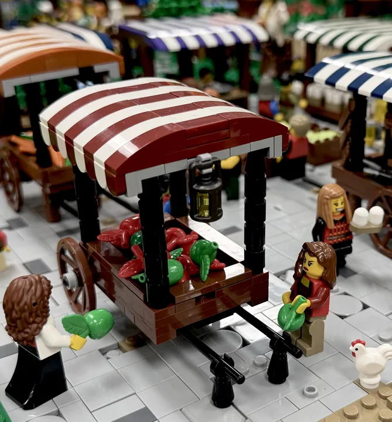 | [ela_market_2026](castle.md#ela_market_2026) | Castles |
|  | [ela_facade_2026](city.md#ela_facade_2026) | Cities and landmarks |
|  | [ela_interior_2026](city.md#ela_interior_2026) | Cities and landmarks |
|  | [ela_aquarium_2026](city.md#ela_aquarium_2026) | Cities and landmarks |
| 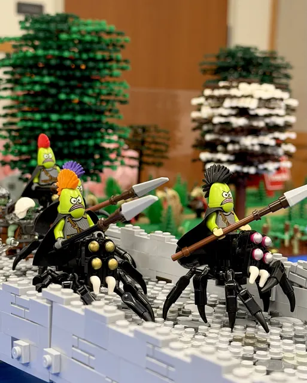 | [ela_spider_riders_2026](screen.md#ela_spider_riders_2026) | Screen and story |
| 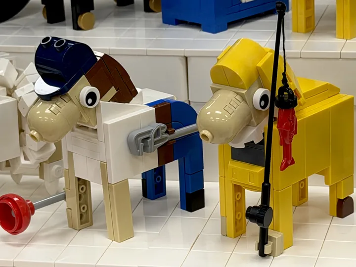 | [ela_characters_2026](creatures.md#ela_characters_2026) | Creatures and characters |
|  | [ela_dog_2026](creatures.md#ela_dog_2026) | Creatures and characters |
|  | [ela_locomotive_2026](trains.md#ela_locomotive_2026) | Rail yards |
|  | [ela_spacecraft_2026](screen.md#ela_spacecraft_2026) | Screen and story |

## 2026-05-02-algonquin

Algonquin Area Public Library - May 2026

A colorful line-up of animals, aircraft, cars, and woodland details.

| Preview | Photograph | Theme |
| --- | --- | --- |
| 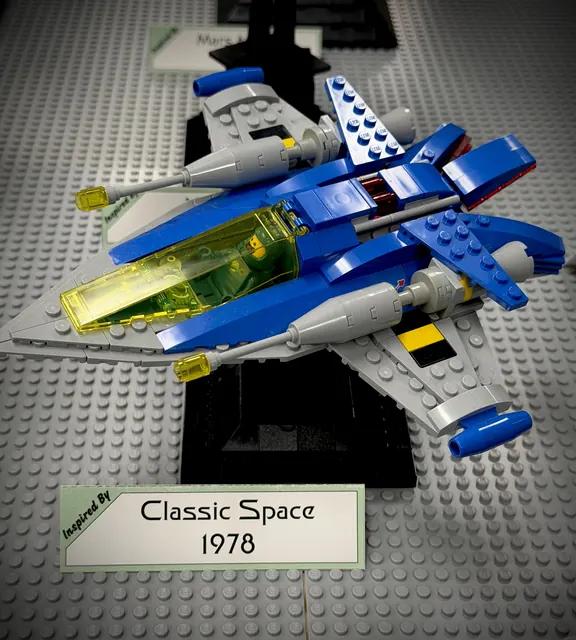 | [algonquin_classic_space_2026](screen.md#algonquin_classic_space_2026) | Screen and story |
| 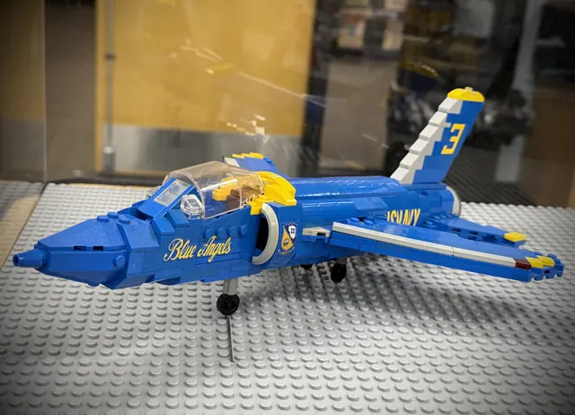 | [algonquin_jet_2026](screen.md#algonquin_jet_2026) | Screen and story |
|  | [algonquin_cars_2026](city.md#algonquin_cars_2026) | Cities and landmarks |
|  | [algonquin_cyclist_2026](city.md#algonquin_cyclist_2026) | Cities and landmarks |
| 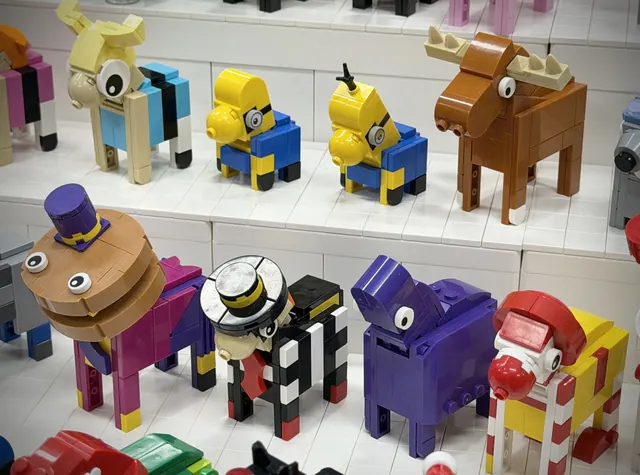 | [algonquin_animals_2026](creatures.md#algonquin_animals_2026) | Creatures and characters |
| 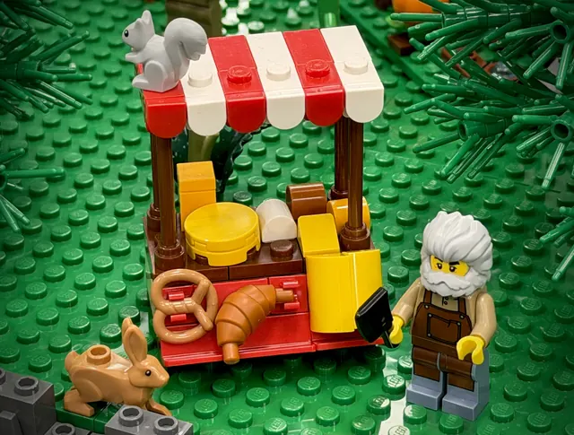 | [algonquin_food_stall_2026](castle.md#algonquin_food_stall_2026) | Castles |
|  | [algonquin_steam_locomotive_2026](trains.md#algonquin_steam_locomotive_2026) | Rail yards |
|  | [algonquin_character_trains_2026](trains.md#algonquin_character_trains_2026) | Rail yards |
|  | [algonquin_industrial_freight_2026](trains.md#algonquin_industrial_freight_2026) | Rail yards |

## 2026-04-11-wheaton

Wheaton Public Library - April 2026

A riverbank, a sailboat, a barn-raising scene, and a very small market.

| Preview | Photograph | Theme |
| --- | --- | --- |
|  | [wheaton_eloise_2026](city.md#wheaton_eloise_2026) | Cities and landmarks |
| 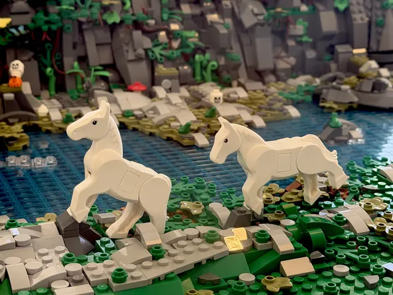 | [wheaton_horses_2026](creatures.md#wheaton_horses_2026) | Creatures and characters |
|  | [wheaton_barn_2026](city.md#wheaton_barn_2026) | Cities and landmarks |
| 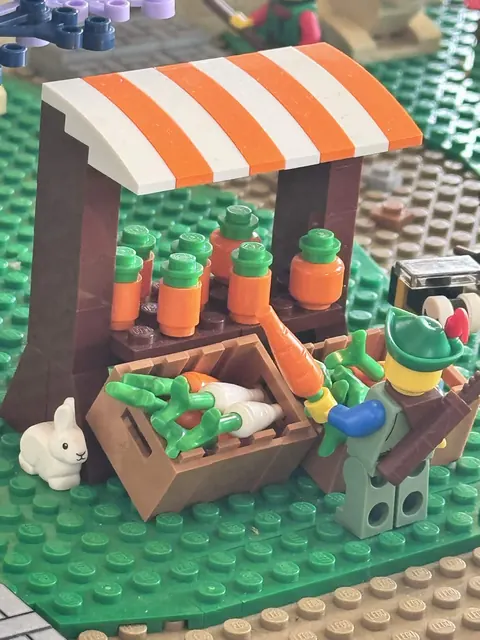 | [wheaton_carrots_2026](castle.md#wheaton_carrots_2026) | Castles |
|  | [wheaton_blue_engine_2026](trains.md#wheaton_blue_engine_2026) | Rail yards |

## 2025-12-13-arlington-heights

Arlington Heights Memorial Library - December 2025

Winter festivities, castle gardens, dinosaurs, and a multitrack rail display.

| Preview | Photograph | Theme |
| --- | --- | --- |
|  | [arlington_winter_market_2025](city.md#arlington_winter_market_2025) | Cities and landmarks |
| 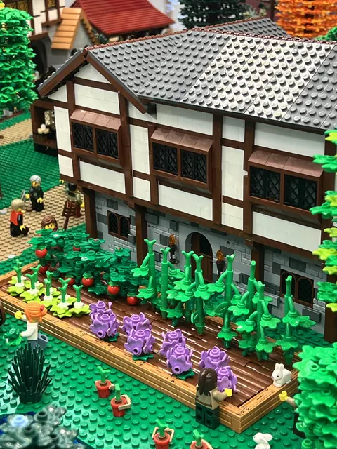 | [arlington_tudor_2025](castle.md#arlington_tudor_2025) | Castles |
| 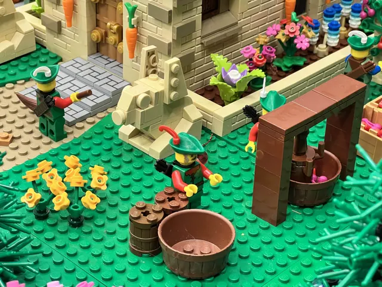 | [arlington_garden_2025](castle.md#arlington_garden_2025) | Castles |
| 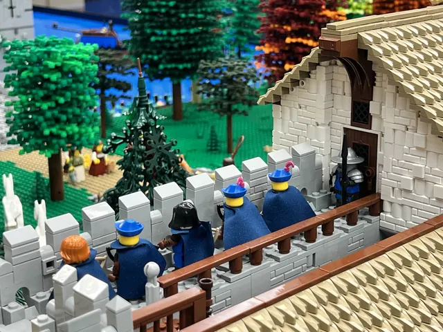 | [arlington_castle_guard_2025](castle.md#arlington_castle_guard_2025) | Castles |
| 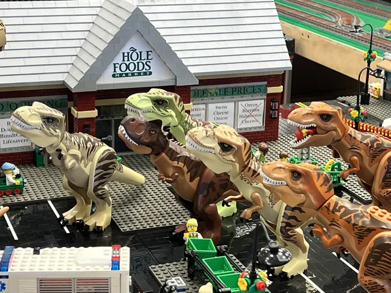 | [arlington_dinosaurs_2025](creatures.md#arlington_dinosaurs_2025) | Creatures and characters |
|  | [arlington_sailboat_2025](city.md#arlington_sailboat_2025) | Cities and landmarks |
|  | [arlington_multitrack_2025](trains.md#arlington_multitrack_2025) | Rail yards |
|  | [arlington_cnrail_8744_2025](trains.md#arlington_cnrail_8744_2025) | Rail yards |
| 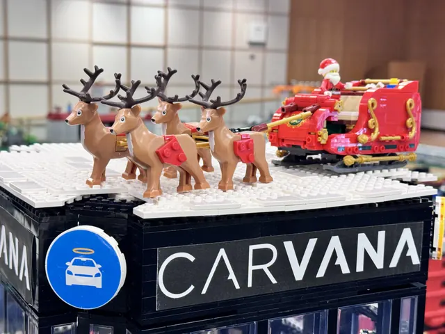 | [arlington_santa_2025](creatures.md#arlington_santa_2025) | Creatures and characters |

## 2025-10-25-oswego

Oswego Public Library - October 2025

Woodland creatures, tall castles, and an unusual helicopter delivery.

| Preview | Photograph | Theme |
| --- | --- | --- |
|  | [oswego_fortress_2025](castle.md#oswego_fortress_2025) | Castles |
| 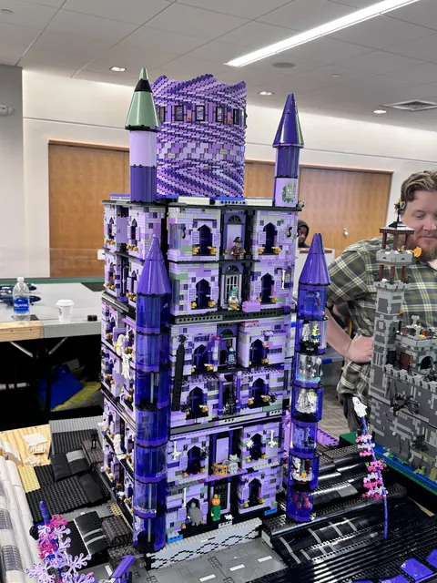 | [oswego_purple_castle_2025](castle.md#oswego_purple_castle_2025) | Castles |
| 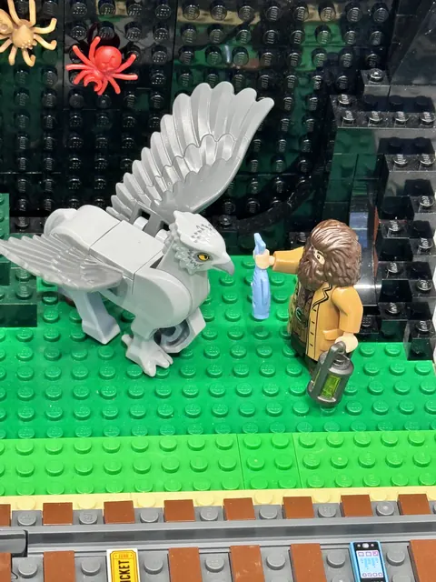 | [oswego_hippogriff_2025](screen.md#oswego_hippogriff_2025) | Screen and story |
| 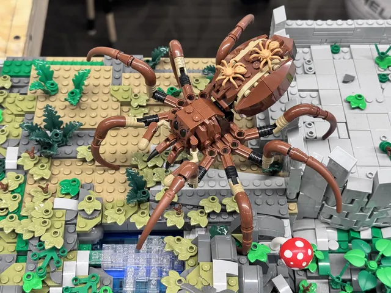 | [oswego_spider_2025](creatures.md#oswego_spider_2025) | Creatures and characters |
| 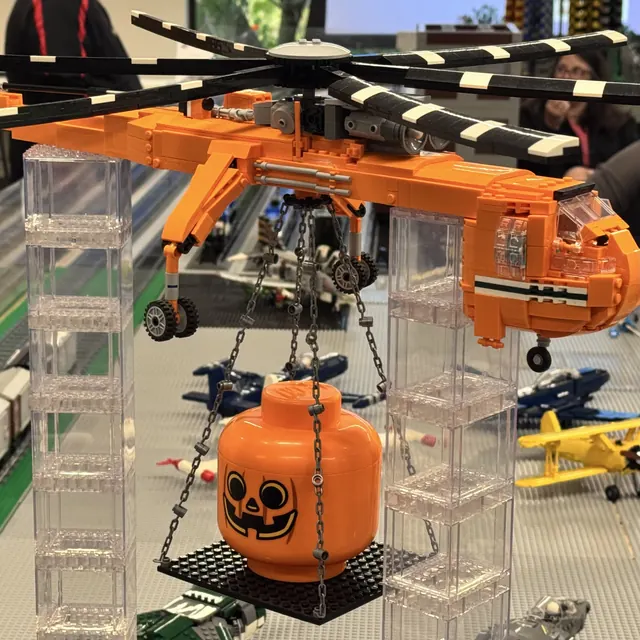 | [oswego_helicopter_2025](screen.md#oswego_helicopter_2025) | Screen and story |

## 2025-09-06-barrington

Barrington Area Library - September 2025

A broad freight yard, an aircraft apron, and a harbor full of life.

| Preview | Photograph | Theme |
| --- | --- | --- |
|  | [barrington_landscape_2025](city.md#barrington_landscape_2025) | Cities and landmarks |
| 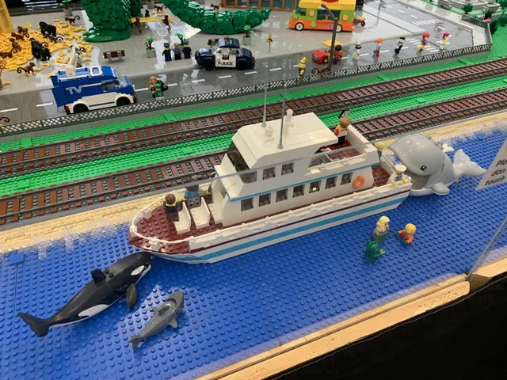 | [barrington_harbor_2025](creatures.md#barrington_harbor_2025) | Creatures and characters |
|  | [barrington_yard_2025](trains.md#barrington_yard_2025) | Rail yards |
| 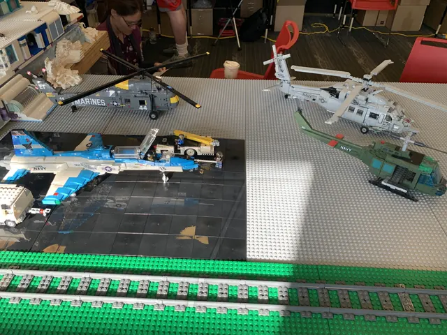 | [barrington_aircraft_2025](screen.md#barrington_aircraft_2025) | Screen and story |
|  | [barrington_gantry_2025](trains.md#barrington_gantry_2025) | Rail yards |
|  | [barrington_metra_2025](trains.md#barrington_metra_2025) | Rail yards |
|  | [barrington_city_rail_2025](trains.md#barrington_city_rail_2025) | Rail yards |
|  | [barrington_containers_2025](trains.md#barrington_containers_2025) | Rail yards |
|  | [barrington_rail_depot_2025](trains.md#barrington_rail_depot_2025) | Rail yards |
