# Rail yards

[README.md](README.md) / [shows.md](shows.md)

## ela_locomotive_2026

Canadian Pacific 7309 at Ela Area, September 2026.

- Event date: 2026-09; capture date: unknown.
- Full image: 1600 x 1200 pixels; 228,510 bytes.
- Crop focus: center (default). Focus controls display framing; follow the image link to inspect the full derivative.
- Homepage pick: no.
- Credit: NILTC archive; uploaded by Kerbear.
- Show: [Ela Area Public Library](shows.md#2026-09-12-ela-area).
- Preserved original: [ela_locomotive_2026.jpg](../../ARTIFACTS/discord_archive_shows/ela_locomotive_2026.jpg).

## northbrook_freight_2026

[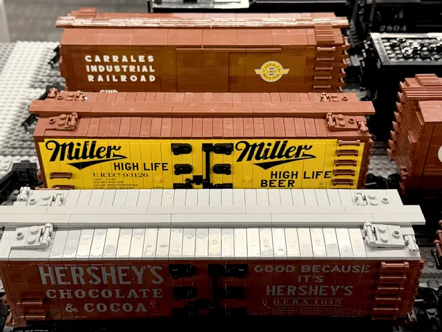](../../design_d_revised/site_src/assets/photos/northbrook_freight_2026.webp)

Freight cars.

- Event date: 2026-10; capture date: unknown.
- Full image: 1600 x 1200 pixels; 189,670 bytes.
- Crop focus: center (default). Focus controls display framing; follow the image link to inspect the full derivative.
- Homepage pick: no.
- Credit: NILTC archive; uploaded by Kerbear.
- Show: [Northbrook Public Library](shows.md#2026-10-17-northbrook).
- Preserved original: [northbrook_freight_2026.jpg](../../ARTIFACTS/discord_archive_shows/northbrook_freight_2026.jpg).

## northbrook_depot_2026

[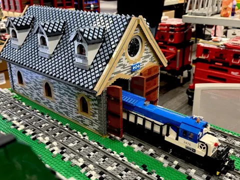](../../design_d_revised/site_src/assets/photos/northbrook_depot_2026.webp)

At the depot.

- Event date: 2026-10; capture date: unknown.
- Full image: 1600 x 1200 pixels; 369,750 bytes.
- Crop focus: center (default). Focus controls display framing; follow the image link to inspect the full derivative.
- Homepage pick: no.
- Credit: NILTC archive; uploaded by Kerbear.
- Show: [Northbrook Public Library](shows.md#2026-10-17-northbrook).
- Preserved original: [northbrook_depot_2026.jpg](../../ARTIFACTS/discord_archive_shows/northbrook_depot_2026.jpg).

## northbrook_crane_2026

[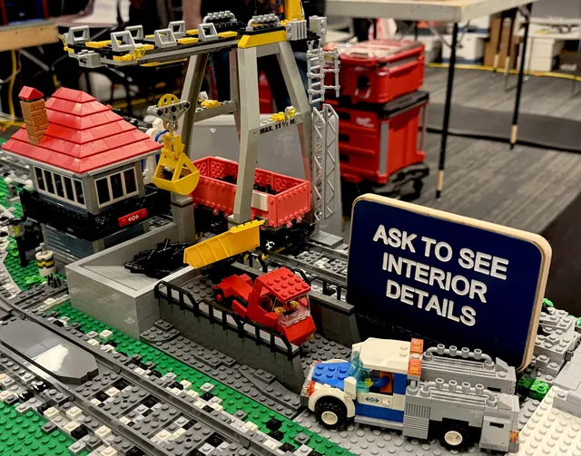](../../design_d_revised/site_src/assets/photos/northbrook_crane_2026.webp)

Freight handling.

- Event date: 2026-10; capture date: unknown.
- Full image: 1600 x 1257 pixels; 283,110 bytes.
- Crop focus: center (default). Focus controls display framing; follow the image link to inspect the full derivative.
- Homepage pick: no.
- Credit: NILTC archive; uploaded by Kerbear.
- Show: [Northbrook Public Library](shows.md#2026-10-17-northbrook).
- Preserved original: [northbrook_crane_2026.jpg](../../ARTIFACTS/discord_archive_shows/northbrook_crane_2026.jpg).

## arlington_multitrack_2025

[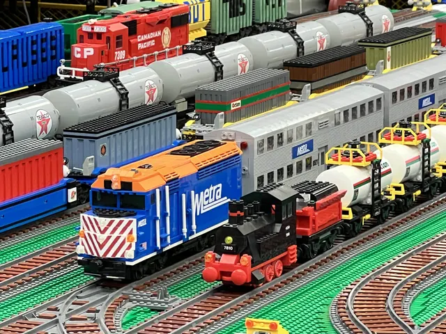](../../design_d_revised/site_src/assets/photos/arlington_multitrack_2025.webp)

Metra on the main line at Arlington Heights, December 2025.

- Event date: 2025-12; capture date: unknown.
- Full image: 1600 x 1200 pixels; 356,534 bytes.
- Crop focus: 45% 55%. Focus controls display framing; follow the image link to inspect the full derivative.
- Homepage pick: no.
- Credit: NILTC archive; uploaded by Kerbear.
- Show: [Arlington Heights Memorial Library](shows.md#2025-12-13-arlington-heights).
- Preserved original: [arlington_multitrack_2025.jpg](../../ARTIFACTS/discord_archive_shows/arlington_multitrack_2025.jpg).

## arlington_cnrail_8744_2025

[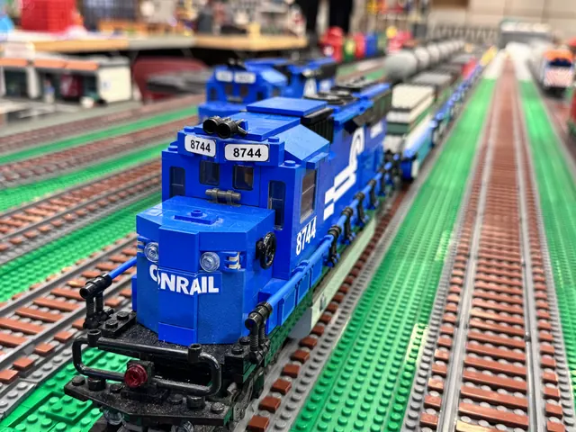](../../design_d_revised/site_src/assets/photos/arlington_cnrail_8744_2025.webp)

CN Rail 8744 at Arlington Heights, December 2025.

- Event date: 2025-12; capture date: unknown.
- Full image: 1600 x 1200 pixels; 219,976 bytes.
- Crop focus: 40% 50%. Focus controls display framing; follow the image link to inspect the full derivative.
- Homepage pick: no.
- Credit: NILTC archive; uploaded by Andertoons.
- Show: [Arlington Heights Memorial Library](shows.md#2025-12-13-arlington-heights).
- Preserved original: [arlington_cnrail_8744_2025.jpg](../../ARTIFACTS/discord_archive_shows/arlington_cnrail_8744_2025.jpg).

## barrington_yard_2025

[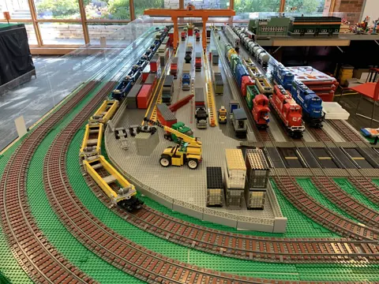](../../design_d_revised/site_src/assets/photos/barrington_yard_2025.webp)

Freight yard.

- Event date: 2025-09; capture date: unknown.
- Full image: 1600 x 1200 pixels; 503,898 bytes.
- Crop focus: center (default). Focus controls display framing; follow the image link to inspect the full derivative.
- Homepage pick: no.
- Credit: NILTC archive; uploaded by Jason C.
- Show: [Barrington Area Library](shows.md#2025-09-06-barrington).
- Preserved original: [barrington_yard_2025.jpg](../../ARTIFACTS/discord_archive_shows/barrington_yard_2025.jpg).

## library_layout

[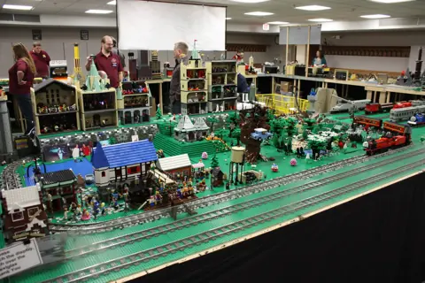](../../design_d_revised/site_src/assets/photos/library_layout.webp)

Library show layout.

- Event date: unknown; capture date: unknown.
- Full image: 1600 x 1067 pixels; 311,658 bytes.
- Crop focus: center (default). Focus controls display framing; follow the image link to inspect the full derivative.
- Homepage pick: no.
- Credit: NILTC / niltc.org.

## layout_2009

[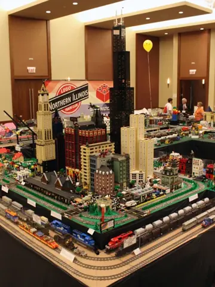](../../design_d_revised/site_src/assets/photos/layout_2009.webp)

Chicago skyline and rail loops, 2009.

- Event date: unknown; capture date: unknown.
- Full image: 432 x 576 pixels; 57,420 bytes.
- Crop focus: center (default). Focus controls display framing; follow the image link to inspect the full derivative.
- Homepage pick: no.
- Credit: NILTC / niltc.org.

## metra_locomotive

[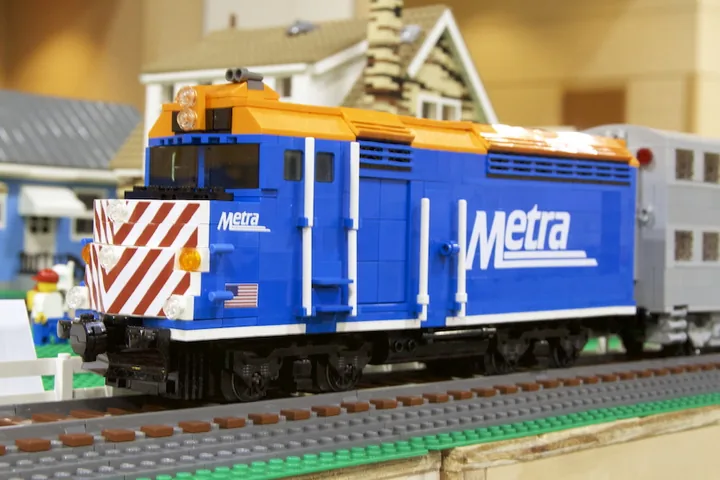](../../design_d_revised/site_src/assets/photos/metra_locomotive.webp)

Metra commuter locomotive.

- Event date: unknown; capture date: unknown.
- Full image: 900 x 600 pixels; 52,912 bytes.
- Crop focus: center (default). Focus controls display framing; follow the image link to inspect the full derivative.
- Homepage pick: no.
- Credit: NILTC / niltc.org.

## caboose

[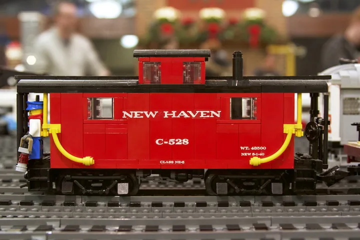](../../design_d_revised/site_src/assets/photos/caboose.webp)

New Haven caboose.

- Event date: unknown; capture date: unknown.
- Full image: 900 x 600 pixels; 51,722 bytes.
- Crop focus: center (default). Focus controls display framing; follow the image link to inspect the full derivative.
- Homepage pick: no.
- Credit: NILTC / niltc.org.

## vintage_steam

[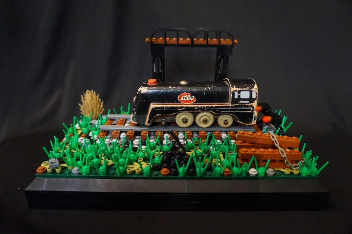](../../design_d_revised/site_src/assets/photos/vintage_steam.webp)

Steam locomotive.

- Event date: unknown; capture date: unknown.
- Full image: 900 x 598 pixels; 48,680 bytes.
- Crop focus: center (default). Focus controls display framing; follow the image link to inspect the full derivative.
- Homepage pick: no.
- Credit: NILTC / niltc.org.

## northbrook_purple_train_2026

[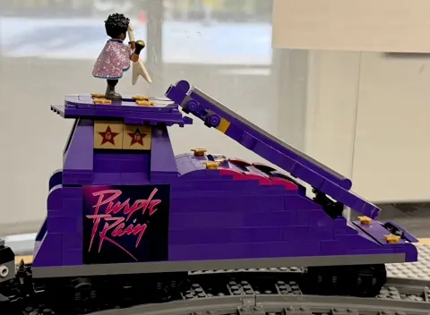](../../design_d_revised/site_src/assets/photos/northbrook_purple_train_2026.webp)

Prince's Purple Rain railcar at Northbrook, October 2026.

- Event date: 2026-10; capture date: unknown.
- Full image: 1600 x 1173 pixels; 113,908 bytes.
- Crop focus: 50% 20%. Focus controls display framing; follow the image link to inspect the full derivative.
- Homepage pick: yes.
- Credit: NILTC archive; uploaded by Kerbear.
- Show: [Northbrook Public Library](shows.md#2026-10-17-northbrook).
- Preserved original: [northbrook_purple_train_2026.jpg](../../ARTIFACTS/discord_archive_shows/northbrook_purple_train_2026.jpg).

## northbrook_1999_railcar_2026

1999 celebration railcar at Northbrook, October 2026.

- Event date: 2026-10; capture date: unknown.
- Full image: 1600 x 1190 pixels; 163,546 bytes.
- Crop focus: center (default). Focus controls display framing; follow the image link to inspect the full derivative.
- Homepage pick: no.
- Credit: NILTC archive; uploaded by Kerbear.
- Show: [Northbrook Public Library](shows.md#2026-10-17-northbrook).
- Preserved original: [northbrook_1999_railcar_2026.jpg](../../ARTIFACTS/discord_archive_shows/northbrook_1999_railcar_2026.jpg).

## algonquin_steam_locomotive_2026

[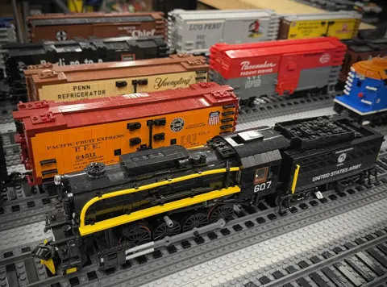](../../design_d_revised/site_src/assets/photos/algonquin_steam_locomotive_2026.webp)

Steam locomotive 607 and freight cars at Algonquin, May 2026.

- Event date: 2026-05; capture date: unknown.
- Full image: 1600 x 1185 pixels; 260,312 bytes.
- Crop focus: center (default). Focus controls display framing; follow the image link to inspect the full derivative.
- Homepage pick: no.
- Credit: NILTC archive; uploaded by Kerbear.
- Show: [Algonquin Area Public Library](shows.md#2026-05-02-algonquin).
- Preserved original: [algonquin_steam_locomotive_2026.jpg](../../ARTIFACTS/discord_archive_shows/algonquin_steam_locomotive_2026.jpg).

## algonquin_character_trains_2026

[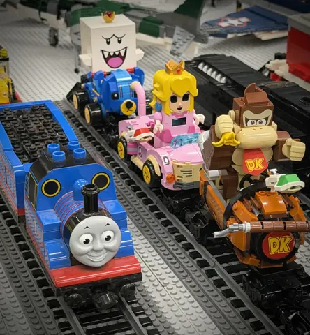](../../design_d_revised/site_src/assets/photos/algonquin_character_trains_2026.webp)

Character-themed engines and railcars at Algonquin, May 2026.

- Event date: 2026-05; capture date: unknown.
- Full image: 1480 x 1600 pixels; 252,394 bytes.
- Crop focus: center (default). Focus controls display framing; follow the image link to inspect the full derivative.
- Homepage pick: no.
- Credit: NILTC archive; uploaded by Kerbear.
- Show: [Algonquin Area Public Library](shows.md#2026-05-02-algonquin).
- Preserved original: [algonquin_character_trains_2026.jpg](../../ARTIFACTS/discord_archive_shows/algonquin_character_trains_2026.jpg).

## algonquin_industrial_freight_2026

[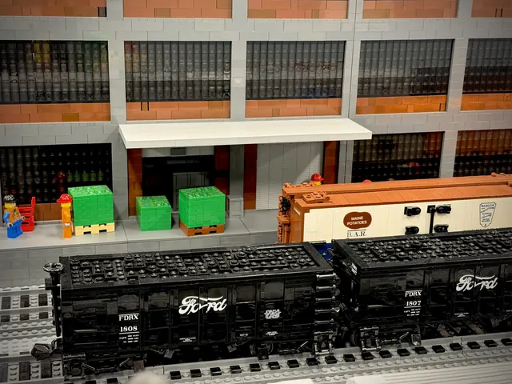](../../design_d_revised/site_src/assets/photos/algonquin_industrial_freight_2026.webp)

Freight loading at Algonquin, May 2026.

- Event date: 2026-05; capture date: unknown.
- Full image: 1600 x 1200 pixels; 260,776 bytes.
- Crop focus: center (default). Focus controls display framing; follow the image link to inspect the full derivative.
- Homepage pick: no.
- Credit: NILTC archive; uploaded by Kerbear.
- Show: [Algonquin Area Public Library](shows.md#2026-05-02-algonquin).
- Preserved original: [algonquin_industrial_freight_2026.jpg](../../ARTIFACTS/discord_archive_shows/algonquin_industrial_freight_2026.jpg).

## barrington_gantry_2025

[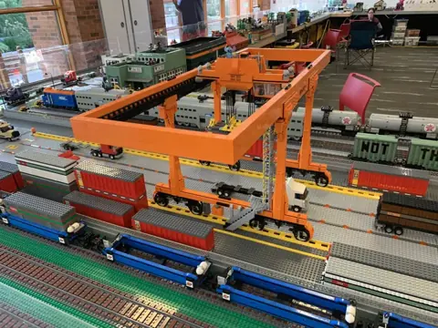](../../design_d_revised/site_src/assets/photos/barrington_gantry_2025.webp)

Intermodal gantry crane.

- Event date: 2025-09; capture date: unknown.
- Full image: 720 x 540 pixels; 92,806 bytes.
- Crop focus: center (default). Focus controls display framing; follow the image link to inspect the full derivative.
- Homepage pick: no.
- Credit: NILTC archive; uploaded by Jason C.
- Show: [Barrington Area Library](shows.md#2025-09-06-barrington).
- Preserved original: [barrington_gantry_2025.jpg](../../ARTIFACTS/discord_archive_shows/barrington_gantry_2025.jpg).

## barrington_metra_2025

[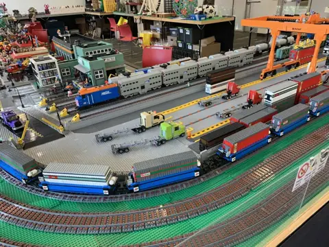](../../design_d_revised/site_src/assets/photos/barrington_metra_2025.webp)

Metra at the container terminal.

- Event date: 2025-09; capture date: unknown.
- Full image: 720 x 540 pixels; 109,344 bytes.
- Crop focus: center (default). Focus controls display framing; follow the image link to inspect the full derivative.
- Homepage pick: no.
- Credit: NILTC archive; uploaded by Jason C.
- Show: [Barrington Area Library](shows.md#2025-09-06-barrington).
- Preserved original: [barrington_metra_2025.jpg](../../ARTIFACTS/discord_archive_shows/barrington_metra_2025.jpg).

## barrington_city_rail_2025

[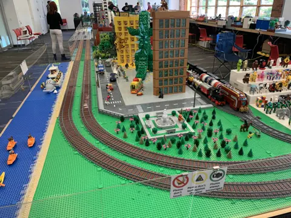](../../design_d_revised/site_src/assets/photos/barrington_city_rail_2025.webp)

City railway.

- Event date: 2025-09; capture date: unknown.
- Full image: 720 x 540 pixels; 107,168 bytes.
- Crop focus: center (default). Focus controls display framing; follow the image link to inspect the full derivative.
- Homepage pick: no.
- Credit: NILTC archive; uploaded by Jason C.
- Show: [Barrington Area Library](shows.md#2025-09-06-barrington).
- Preserved original: [barrington_city_rail_2025.jpg](../../ARTIFACTS/discord_archive_shows/barrington_city_rail_2025.jpg).

## barrington_containers_2025

[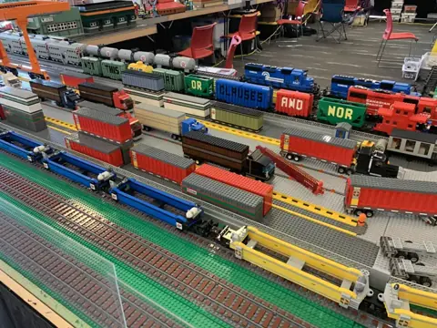](../../design_d_revised/site_src/assets/photos/barrington_containers_2025.webp)

Container and tank trains.

- Event date: 2025-09; capture date: unknown.
- Full image: 720 x 540 pixels; 101,498 bytes.
- Crop focus: center (default). Focus controls display framing; follow the image link to inspect the full derivative.
- Homepage pick: no.
- Credit: NILTC archive; uploaded by Jason C.
- Show: [Barrington Area Library](shows.md#2025-09-06-barrington).
- Preserved original: [barrington_containers_2025.jpg](../../ARTIFACTS/discord_archive_shows/barrington_containers_2025.jpg).

## barrington_rail_depot_2025

[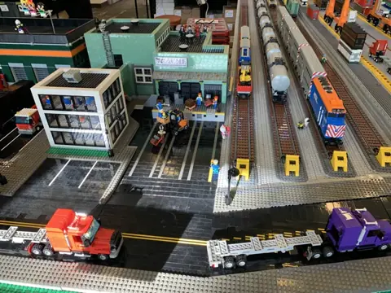](../../design_d_revised/site_src/assets/photos/barrington_rail_depot_2025.webp)

Railway depot.

- Event date: 2025-09; capture date: unknown.
- Full image: 720 x 540 pixels; 85,120 bytes.
- Crop focus: center (default). Focus controls display framing; follow the image link to inspect the full derivative.
- Homepage pick: no.
- Credit: NILTC archive; uploaded by Jason C.
- Show: [Barrington Area Library](shows.md#2025-09-06-barrington).
- Preserved original: [barrington_rail_depot_2025.jpg](../../ARTIFACTS/discord_archive_shows/barrington_rail_depot_2025.jpg).

## wheaton_blue_engine_2026

[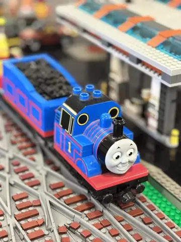](../../design_d_revised/site_src/assets/photos/wheaton_blue_engine_2026.webp)

Blue engine at the station.

- Event date: 2026-04; capture date: unknown.
- Full image: 540 x 720 pixels; 39,386 bytes.
- Crop focus: center (default). Focus controls display framing; follow the image link to inspect the full derivative.
- Homepage pick: no.
- Credit: NILTC archive; uploaded by Andertoons.
- Show: [Wheaton Public Library](shows.md#2026-04-11-wheaton).
- Preserved original: [wheaton_blue_engine_2026.jpg](../../ARTIFACTS/discord_archive_shows/wheaton_blue_engine_2026.jpg).
