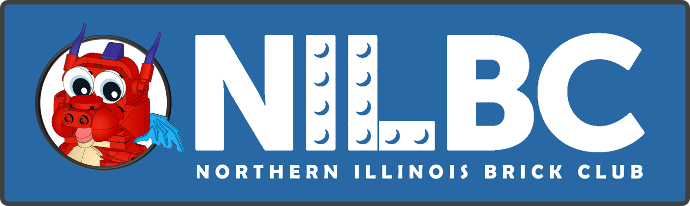

---
hide:
  - navigation
  - toc
---

# Northern Illinois Brick Club website designs

Explore three revisions of Design D, followed by the four original proposals.
All use the same club brief and approved artwork.

## The D revisions

All three use "Many interests. One club.", tighter copy, and the same club photographs.
They remove the Christmas lights and keep the familiar navigation and light/dark controls.

| Design | Visual direction | Open the website |
| --- | --- | --- |
| D&beta; | Suggested direction: solid backgrounds, larger photographs, handwritten captions | [Explore Design D&beta;](d-beta/) |
| D&alpha; | Restrained: familiar D layout, faint banner studs, calm body backgrounds | [Explore Design D&alpha;](d-alpha/) |
| D&gamma; | Playful: a miniature exhibition meets a colorful club-poster collage | [Explore Design D&gamma;](d-gamma/) |

Start with D&beta;, then compare all three in the same color mode and try the other mode.
Which details would you keep, and which would you change? Check them on a phone too.

## Original proposals

| Design | Open the complete website |
| --- | --- |
| A | [Explore Design A](a/) |
| B | [Explore Design B](b/) |
| C | [Explore Design C](c/) |
| D | [Explore Design D](d/) |

Try the homepage, shows, creations, and joining pages in each design. Compare them on your
phone as well as a larger screen. Use your browser's Back button to return to this page.

These are design proposals for club review. The
[existing club website](https://niltc.org/) remains the source for current club information.
